# TÀI LIỆU ÔN TẬP CẤP TỐC 2 NGÀY ĐẠT 9–10 ĐIỂM: SWD392 PRACTICAL EXAM (PE)
> **Biên soạn sát 100% các câu hỏi có thật trong 10 đề thi thực tế tại thư mục `FA26_On_Tap` (`SU25`, `Fall25`, `SP26`, `FA26_Example`, `SU26`)**  
> **Nguyên tắc tối thượng của tài liệu này:** **KHÔNG học lan man, KHÔNG ôn nội dung ngoài lề.** Chỉ tập trung 100% vào đúng các dạng câu hỏi, loại sơ đồ, Design Pattern và Kiến trúc đã thực sự xuất hiện trong các đề thi trước đây.

---

# PHẦN A. PHÂN TÍCH CÁC ĐỀ THI TRƯỚC ĐÂY (100% DỮ LIỆU THẬT)

## 1. Bảng thống kê 10 đề thi & 4 mẫu phiếu trả lời (`_ID`) trong `FA26_On_Tap`

Qua việc đọc toàn bộ các file trong thư mục, toàn bộ các đề thi SWD392 PE chia làm **3 nhóm cấu trúc đề** rất rõ ràng:

| STT | Kỳ | Tên File Đề | Domain (Bài toán) | Các câu hỏi & Yêu cầu cụ thể trong đề | Điểm từng câu |
| :-: | :--- | :--- | :--- | :--- | :--- |
| **1** | **FA26_Example** *(SPR26)* | `SWD392_PE_SPR26_Exam_Documentation.md` *(+ file `_ID`)* | Đặt phòng Homestay (**StayEase**) | **Kiến trúc bắt buộc:** Layered Architecture + **Repository Pattern** (`IGenericRepository`)<br>• **Q1:** Design-level **Class Diagram** (`User` $\leftarrow$ `Customer`/`Host`, `Room`, `Reservation`, `Payment`, `BookingService`, `IGenericRepository`, `RoomRepository`, `ReservationRepository`)<br>• **Q2:** **Sequence Diagram** đặt phòng (2 khung `alt`: kiểm tra phòng trống & kết quả thanh toán cọc)<br>• **Q3:** **Activity Diagram** trả phòng & kiểm tra hư hỏng (2 Swimlanes: `Host` & `System`, Decision Node tính phí đền bù, cập nhật trạng thái `Reservation="Completed"` & `Room="Cleaning"`). | **Q1:** 3.0đ<br>**Q2:** 4.0đ<br>**Q3:** 3.0đ |
| **2** | **SP26** | `SWD392_SP26_EventManagementSystem_LêQuangĐạt.md` *(+ file `_ID`)* | Quản lý sự kiện ĐH FPT (**EMS**) | **Kiến trúc bắt buộc:** Layered/Microservices + **Repository Pattern**<br>• **Q1:** Design-level **Class Diagram** (`User` $\leftarrow$ `Student`/`Lecturer`/`Organizer`/`Admin`, `Event`, `Registration`, `Service`, `Repository<T>`)<br>• **Q2:** **Sequence Diagram** đăng ký sự kiện (2 khung `alt`: sự kiện đang mở/đóng & còn chỗ/hết chỗ)<br>• **Q3:** **State Diagram** vòng đời `Event` (`Draft`, `Approved`, `OpenForRegistration`, `Full`, `Ongoing`, `Completed` + `Cancelled`/`Rejected`, $\ge 6$ transitions). | **Q1:** 3.0đ<br>**Q2:** 4.0đ<br>**Q3:** 3.0đ |
| **3** | **SU26** | `SWD392_SU26_PE1.md` *(+ file `PE1_SU26_ID`)* | Bãi đỗ xe thông minh (**SmartPark**) | **Kiến trúc bắt buộc:** Layered/Microservices + **Repository Pattern**<br>• **Q1:** Design-level **Class Diagram** (`User` $\leftarrow$ `Customer`/`ParkingStaff`, `Vehicle`, `ParkingTicket`, `ParkingSlot`, `Payment`, `Service`, `Repository`)<br>• **Q2:** **Sequence Diagram** xe vào bãi & cấp vé (`Camera/Gate UI` $\rightarrow$ `Controller/Service` $\rightarrow$ `Repositories`, khung `alt`: còn chỗ vs hết chỗ)<br>• **Q3:** **Activity Diagram** xe ra bãi & thanh toán (2 Swimlanes: `Customer` & `System`, Decision Node thanh toán thất bại thì thử lại, cập nhật `ParkingTicket` & `ParkingSlot`). | **Q1:** 3.0đ<br>**Q2:** 4.0đ<br>**Q3:** 3.0đ |
| **4** | **SU26** | `SWD392_SU26_MediCareHub_PE2.md` *(+ file `PE2_SU26_ID`)* | Đặt lịch khám bệnh (**MediCare Hub**) | **Kiến trúc bắt buộc:** Layered/Microservices + **Repository Pattern**<br>• **Q1:** Design-level **Class Diagram** (`User` $\leftarrow$ `Patient`/`Doctor`/`Receptionist`, `Appointment`, `Payment`, `DoctorSchedule`, `Service`, `Repository<T>`)<br>• **Q2:** **Sequence Diagram** đặt lịch khám & đóng phí (2 khung `alt`: bác sĩ có lịch trống & thanh toán thành công/thất bại)<br>• **Q3:** **State Diagram** vòng đời `Appointment` (`Pending`, `Confirmed`, `CheckedIn`, `InConsultation`, `Completed` + `Cancelled`/`PaymentFailed`, $\ge 6$ transitions). | **Q1:** 3.0đ<br>**Q2:** 4.0đ<br>**Q3:** 3.0đ |
| **5** | **SU25** | `SWD392_PracticalExam_CyberAIFPTx_LêQuangĐạt.md` | Cổng quản trị sinh viên (**Cyber AI FPTx**) | • **Q1:** **Class Diagram** (`Student`, `Course`, `GradeReport` là **Association Class**)<br>• **Q2:** **Sequence Diagram** đăng ký môn học (gắn stereotype `«boundary»`, `«control»`, `«service»`, `«entity»`)<br>• **Q3:** **Statechart Diagram** (`StudentAcademicStatus`: `GoodStanding`, `AcademicWarning`, `AcademicProbation`, `Dismissed`, guard `[GPA < 5.0]`)<br>• **Q4:** Đề xuất **Software Architecture** cho web truyền thống (tên, lý do, 1 ưu, 1 nhược)<br>• **Q5:** Nhận diện Behavioral Pattern cho danh sách chờ môn học $\rightarrow$ **Observer Pattern**. | **Q1:** 3.0đ<br>**Q2:** 3.0đ<br>**Q3:** 2.0đ<br>**Q4:** 1.0đ<br>**Q5:** 1.0đ |
| **6** | **SU25** | `SWD392_SU25_FinalExam_LêQuangĐạt.md` | Cổng thông tin ĐH (**Final Exam SU25**) | • **Q1:** **Class Diagram** mức Entity (`University`, `Department`, `Professor`, `Tenured`, `Adjunct`) thể hiện **Composition, Aggregation, Generalization**<br>• **Q2:** **Sequence Diagram** xem điểm (`GradesView` «boundary», `GradesController` «control», `StudentGradesService` «service», `GradesRecord` «entity»)<br>• **Q3:** **Statechart Diagram** (`CourseEnrollment`: `Registered`, `Active`, `Dropped`, `Passed`, `Failed`)<br>• **Q4:** Đề xuất **Software Architecture** (tên, 2 ưu, 1 nhược)<br>• **Q5:** Nhận diện Pattern cho đối tượng cấu hình duy nhất toàn cục $\rightarrow$ **Singleton Pattern**. | **Q1:** 3.0đ<br>**Q2:** 3.0đ<br>**Q3:** 2.0đ<br>**Q4:** 1.0đ<br>**Q5:** 1.0đ |
| **7** | **SU25** | `SWD392_CinemaManagement_PracticalExam_LêQuangĐạt.md` | Quản lý rạp chiếu phim (**Cinema**) | • **Part 1:** (1.1) Liệt kê Entity & Attribute, (1.2) **Conceptual ERD**, (1.3) **Use Case Diagram**, (1.4) Liệt kê trạng thái & **State Diagram** (`Booking`)<br>• **Part 2:** Chức năng *"create booking"*: (2.1) **Class Diagram** (Client + Server MVC: Controller, Service, Repository), (2.2) **Sequence Diagram** (có AuthN/AuthZ)<br>• **Part 3:** Đọc code Java (`ShowtimeSubject`, `Notification`) $\rightarrow$ Nhận diện **Observer Pattern** (Behavioral), vẽ **Class Diagram** Pattern, nêu tình huống. | **P1:** 5.0đ (1+1+1.5+1.5)<br>**P2:** 3.0đ (1.5+1.5)<br>**P3:** 2.0đ (0.5+1+0.5) |
| **8** | **SU25** | `SWD392_FlowerShop_PracticalExam_LêQuangĐạt.md` | Cửa hàng hoa (**Flower Shop**) | • **Part 1:** (1.1) Liệt kê Entity & Attribute, (1.2) **Conceptual ERD**, (1.3) **Logical ERD** (PK/FK, data types), (1.4) **State Diagram** (`Order`)<br>• **Part 2:** Chức năng *"create order"*: (2.1) **Class Diagram** (Client + Server MVC), (2.2) **Sequence Diagram** (có AuthN/AuthZ)<br>• **Part 3:** Đọc code Java (`Pricing`, `RegularPricing`, `VIPPricing`, `FlowerOrder`) $\rightarrow$ Nhận diện **Strategy Pattern** (Behavioral), vẽ **Class Diagram** Pattern, nêu tình huống. | **P1:** 5.0đ (1+1+1.5+1.5)<br>**P2:** 3.0đ (1.5+1.5)<br>**P3:** 2.0đ (0.5+1+0.5) |
| **9** | **SU25** | `SWD392_StudentManagement_PracticalExam_LêQuangĐạt.md` | Quản lý sinh viên & điểm danh | • **Part 1:** (1.1) Liệt kê Entity & Attribute, (1.2) **Conceptual ERD**, (1.3) **Logical ERD**, (1.4) **State Diagram** (`Student` học 1 môn)<br>• **Part 2:** Chức năng *"register subject"*: (2.1) Mô tả chữ Class/Table (Client, Server MVC, DB), (2.2) **Sequence Diagram** (có AuthN/AuthZ)<br>• **Part 3:** Đọc mô tả chữ $\rightarrow$ Nhận diện **Singleton Pattern** (Creational), viết **Pseudocode**, nêu tình huống. | **P1:** 5.0đ (1+1+1.5+1.5)<br>**P2:** 3.0đ (1.0+2.0)<br>**P3:** 2.0đ (0.5+1+0.5) |
| **10** | **Fall25** | `SWD392_PracticalExam_LêQuangĐạt.md` | Đặt đồ ăn trực tuyến (**Online Food**) | • **Part 1:** (1.1) Liệt kê Entity & Attribute, (1.2) **Conceptual ERD**, (1.3) **Logical ERD**, (1.4) **State Diagram** (`Order`/`Dish`)<br>• **Part 2:** Chức năng *"place order"*: (2.1) Mô tả chữ Class/Table (Client, Server MVC, DB), (2.2) **Sequence Diagram** (có AuthN/AuthZ)<br>• **Part 3:** Đọc code Java (`Dish`, `BasicDish`, `DishDecorator`, `CheeseDecorator`) $\rightarrow$ Nhận diện **Decorator Pattern** (Structural), vẽ **Class Diagram** Pattern, nêu tình huống. | **P1:** 5.0đ (1+1+1.5+1.5)<br>**P2:** 3.0đ (1.0+2.0)<br>**P3:** 2.0đ (0.5+1+0.5) |

---

## 2. Danh sách DUY NHẤT các nội dung đã từng ra thi (Không học ngoài danh sách này!)

Dựa hoàn toàn trên 10 đề trên, bạn **CHỈ CẦN ÔN ĐÚNG 7 HẠNG MỤC SAU** (bỏ qua hoàn toàn Component Diagram, Deployment Diagram, Quality Attributes lý thuyết hay các Pattern chưa từng ra):

| STT | Nội dung đã ra trong đề | Tần suất trong 10 đề | Tần suất ở 4 đề mới nhất (`SP26`, `FA26_Ex`, `SU26`) | Xếp loại mức độ |
| :-: | :--- | :--: | :--: | :---: |
| **1** | **Sequence Diagram** (Phân tầng `Actor -> UI -> Controller -> Service -> Repository -> Entity/DB`, có `alt`) | **10 / 10 (100%)** | **4 / 4 (100%)** – **4.0 điểm** | **CHẮC CHẮN RA (100%)** |
| **2** | **Class Diagram** (Gồm: Design-level có `User` kế thừa + `Entity` + `Repository Pattern`; hoặc Association Class; hoặc Class Diagram của Pattern) | **10 / 10 (100%)** | **4 / 4 (100%)** – **3.0 điểm** | **CHẮC CHẮN RA (100%)** |
| **3** | **Statechart Diagram (State Diagram)** (Vòng đời của `Event`, `Appointment`, `Booking`, `Order`, `StudentStatus`) | **8 / 10 (80%)** | **2 / 4 (50%)** – **3.0 điểm** | **RẤT HAY RA (Câu 3)** |
| **4** | **Activity Diagram có 2 Swimlanes** (`Host/Customer` và `System`, có Decision Node hình thoi) | **2 / 10 (20%)** | **2 / 4 (50%)** – **3.0 điểm** | **RẤT HAY RA (Câu 3)** |
| **5** | **Đúng 5 Design Patterns đã xuất hiện:**<br>1. **Repository Pattern** (`IGenericRepository<T>`)<br>2. **Observer Pattern**<br>3. **Strategy Pattern**<br>4. **Singleton Pattern**<br>5. **Decorator Pattern** | **10 / 10 (100%)** | **4 / 4 (100%)** *(Repository Pattern bắt buộc trong Q1 & Q2)* | **CHẮC CHẮN RA (100%)** |
| **6** | **ERD (Conceptual ERD & Logical ERD)** | **4 / 10 (40%)** | **0 / 4 (0%)** *(Chỉ có ở đề 3 Parts SU25/Fall25)* | **HAY RA (Ở Format 3 Parts)** |
| **7** | **Use Case Diagram** & **Câu hỏi chọn Architecture Style (Layered Architecture)** | **Use Case: 1/10**<br>**Arch: 2/10 trực tiếp + 4/4 áp dụng** | Áp dụng **Layered Architecture** trong cả 4 đề mới | **ÍT RA RIÊNG LẺ (Nhưng rất dễ ăn điểm)** |

---

## 3. Quy luật "Khuôn đúc" của đề thi & Các "Bẫy" lặp lại

### Quy luật A: Đối với Đề Format Mới (85 phút – 3 Câu = 10 điểm: `FA26_Example`, `SP26`, `SU26_PE1`, `SU26_PE2`)
1. **Câu 1 – Design-level Class Diagram (3.0 điểm):**
   - **Luôn có 3 cụm cố định:**
     - **Cụm 1 (Inheritance):** Lớp cha `User` và 2–4 lớp con kế thừa từ `User` (mũi tên nét liền, tam giác rỗng chỉ về `User`).
     - **Cụm 2 (Domain Entities):** 3–4 thực thể nghiệp vụ nối với nhau bằng `Association`, `Aggregation`, `Composition` (hình thoi đặc ở lớp chính như `Reservation`/`Appointment`/`Event`, đầu kia là `Payment`/`Registration`), có ghi rõ `1`, `0..1`, `0..*`, `1..*`.
     - **Cụm 3 (Service & Repository Pattern):** Lớp `XxxService` phụ thuộc (`Dependency` – nét đứt mũi tên hở `..>`) vào interface `IGenericRepository<T>` (hoặc `IRepository<T>`); các lớp `XxxRepository` thực thi (`Realization` – **nét đứt tam giác rỗng** `<|..`) interface đó.
2. **Câu 2 – Sequence Diagram (4.0 điểm):**
   - Đi qua đúng các cột: `Actor` $\rightarrow$ `«boundary» UI/Portal` $\rightarrow$ `«control» Controller` $\rightarrow$ `«service» Service` $\rightarrow$ `«repository» Repositories` $\rightarrow$ `«entity» Entities`.
   - **Bẫy lặp lại ở cả 4 đề:** Luôn bắt vẽ khung **`alt`** cho **2 điều kiện**:
     - Điều kiện 1: Kiểm tra tài nguyên còn trống/đang mở không (`[Available / Open]` vs `[else: Occupied / Full / Closed]`).
     - Điều kiện 2: Kiểm tra thanh toán/điều kiện thứ hai (`[Payment Success]` vs `[else: Payment Failed]`).
3. **Câu 3 – State Diagram HOẶC Activity Diagram (3.0 điểm):**
   - **Đề chẵn/lẻ chia đôi:** Nếu đề ra **State Diagram** (`SP26`, `SU26_PE2`) thì yêu cầu $\ge 6$ transitions có tên sự kiện + ít nhất 1 trạng thái hủy/lỗi (`Cancelled`, `Rejected`, `PaymentFailed`). Nếu đề ra **Activity Diagram** (`FA26_Example`, `SU26_PE1`) thì yêu cầu $\ge 2$ **Swimlanes** (`Customer/Host` & `System`) + **Decision Node** (hình thoi) + bước cập nhật trạng thái cho cả 2 thực thể ở cuối bài.
4. **Bẫy trong file nộp bài (`_ID.docx`):** Dưới mỗi câu trong file mẫu nộp bài đều có dòng **`Brief Explanation:`**. Phải viết 3–4 câu giải thích ngắn gọn (đã có mẫu điền sẵn ở Phần D.6).

### Quy luật B: Đối với Đề Format 3 Parts (90 phút: `SU25` Cinema, FlowerShop, Student, `Fall25` Food)
- **Part 1 (5.0 điểm):** Câu 1.1 liệt kê Entities & Attributes (1đ) $\rightarrow$ Câu 1.2 vẽ **Conceptual ERD** (1đ - không FK, không kiểu dữ liệu) $\rightarrow$ Câu 1.3 vẽ **Logical ERD** có PK/FK và kiểu dữ liệu (1.5đ, riêng đề Cinema thay bằng **Use Case Diagram**) $\rightarrow$ Câu 1.4 vẽ **State Diagram** (1.5đ).
- **Part 2 (3.0 điểm):** Thiết kế cho 1 chức năng tạo mới (*create booking / create order / place order / register subject*): Câu 2.1 vẽ **Class Diagram** (hoặc mô tả chữ các class Client, Controller, Service, Repository, DB) (1–1.5đ) $\rightarrow$ Câu 2.2 vẽ **Sequence Diagram** có bước **Authentication & Authorization** (1.5–2đ).
- **Part 3 (2.0 điểm):** Cho sẵn 1 đoạn code Java (hoặc 2 câu mô tả chữ) $\rightarrow$ (3.1) Gọi tên Pattern + Họ Pattern (*Creational / Structural / Behavioral*) (0.5đ) $\rightarrow$ (3.2) Vẽ Class Diagram của Pattern đó (hoặc viết Pseudocode với Singleton) (1.0đ) $\rightarrow$ (3.3) Nêu 1 ví dụ thực tế áp dụng Pattern đó (0.5đ).

---

## 4. Barem chấm điểm (Suy đoán sát thực tế chấm PE) & Các lỗi bị trừ điểm

| Loại câu hỏi | Điểm câu | Chia điểm thành phần (Suy đoán từ rubric chấm PE) | Lỗi mất điểm nhiều nhất cần tránh |
| :--- | :--: | :--- | :--- |
| **Class Diagram**<br>*(Q1 đề mới: 3.0đ / P2.1 đề cũ: 1.5đ)* | **3.0đ** | • Đủ Class (`User` + Roles + Entities + Service + `IGenericRepository` + Repositories): **0.75đ**<br>• Đúng mũi tên **Inheritance** (`User` $\leftarrow$ Roles) & **Realization** (nét đứt tam giác rỗng cho `Repository`): **0.75đ**<br>• Đúng **Association / Aggregation / Composition** + ghi đủ **Multiplicity** (`1`, `0..*`): **0.75đ**<br>• Đủ Attributes (`-`), Methods (`+`), Stereotypes + `Brief Explanation`: **0.75đ** | • Vẽ Realization từ `Repository` lên `IGenericRepository` bằng **nét liền**: **-0.5đ**<br>• Quên ghi số `1`, `0..*` ở 2 đầu dây nối: **-0.5đ**<br>• Đặt ngược đầu hình thoi Composition: **-0.25đ** |
| **Sequence Diagram**<br>*(Q2 đề mới: 4.0đ / P2.2 đề cũ: 1.5–2.0đ)* | **4.0đ** | • Khung `sd` + Đúng thứ tự Lifelines (`Actor -> UI -> Controller -> Service -> Repo -> Entity`): **0.75đ**<br>• Thể hiện rõ lời gọi hàm qua **Repository** (`checkAvailability`, `save`, `updateStatus`): **0.75đ**<br>• Khung `alt` số 1 (còn chỗ vs hết chỗ) có điều kiện `[...]`: **1.0đ**<br>• Khung `alt` số 2 (thanh toán thành công vs thất bại): **0.75đ**<br>• Đánh số message + Mũi tên trả về **nét đứt** + `Brief Explanation`: **0.75đ** | • Cho `Actor`/`UI` gọi nhảy cóc thẳng vào `Repository`/`DB`: **-1.0đ**<br>• Thiếu khung `alt` hoặc thiếu nhánh `[else]`: **-0.75đ**<br>• Vẽ mũi tên trả kết quả về bằng nét liền: **-0.5đ** |
| **State Diagram**<br>*(Q3 đề mới: 3.0đ / P1.4 đề cũ: 1.5đ)* | **3.0đ** | • Có Initial State `●` và Final State `◉`: **0.5đ**<br>• Đủ các trạng thái chính + trạng thái hủy/lỗi (`Cancelled`/`Rejected`/`PaymentFailed`): **1.0đ**<br>• Đủ $\ge 6$ mũi tên chuyển trạng thái, mỗi mũi tên có ghi tên `event`: **1.25đ**<br>• `Brief Explanation`: **0.25đ** | • Vẽ mũi tên nối các trạng thái nhưng **quên ghi tên sự kiện (event)** trên mũi tên: **-1.0đ**<br>• Thiếu trạng thái `Cancelled`/`Failed`: **-0.5đ** |
| **Activity Diagram**<br>*(Q3 đề mới: 3.0đ)* | **3.0đ** | • Chia đúng $\ge 2$ cột **Swimlanes** (`Customer/Host` & `System`) + Initial `●` / Final `◉`: **0.75đ**<br>• Đặt đúng các Action (Động từ) vào đúng cột Swimlane: **0.75đ**<br>• Dùng đúng hình thoi **Decision Node** có nhánh `[Yes]`/`[No]`: **0.75đ**<br>• Cập nhật trạng thái cho cả 2 thực thể ở cuối quy trình + `Brief Explanation`: **0.75đ** | • Không chia cột Swimlanes: **-1.0đ**<br>• Rẽ nhánh không qua hình thoi Decision Node: **-0.5đ**<br>• Quên bước cập nhật trạng thái cuối bài: **-0.5đ** |
| **ERD & Use Case & Design Pattern**<br>*(Đề 3 Parts SU25/Fall25)* | **ERD: 2.5đ**<br>**UC: 1.5đ**<br>**Pattern: 2.0đ** | • **Conceptual ERD:** Đủ Entities, Attributes, gạch chân khóa, đúng quan hệ `1-N`/`N-N`, không ghi FK/kiểu dữ liệu (**1.0đ**); **Logical ERD:** Tách bảng trung gian + PK/FK + kiểu dữ liệu (**1.5đ**).<br>• **Pattern:** Đúng tên + họ Pattern (**0.5đ**), đúng Class Diagram/Pseudocode (**1.0đ**), đúng tình huống thực tế (**0.5đ**). | • Viết FK và kiểu dữ liệu vào Conceptual ERD: **-0.5đ**<br>• Vẽ ngược chiều mũi tên `«include»` và `«extend»` hoặc dùng UC `Manage...`: **-0.5đ** |

---

# PHẦN B. LỘ TRÌNH ÔN TẬP 2 NGÀY (CHỈ ÔN NHỮNG GÌ ĐỀ THI HỎI)

## NGÀY 1: "BIẾT VẼ" – LÀM CHỦ 6 LOẠI SƠ ĐỒ TRONG ĐỀ THI

| Buổi / Khung giờ | Thời lượng | Mục tiêu trọng tâm (Bám sát đề thi) | Nội dung học & Thực hành ngay | Bài tập lấy từ đề thật | Tiêu chí "XONG" (Điểm kiểm tra cuối buổi) |
| :--- | :--: | :--- | :--- | :--- | :--- |
| **Ca 1: Sáng**<br>*(08:00 – 10:30)* | **2.5 giờ** | **Làm chủ Câu 1: Class Diagram (3.0đ) + Repository Pattern + Association Class** | 1. Học 6 mũi tên của Class Diagram (Mục C.1).<br>2. Học khuôn 3 cụm của đề mới: `User` kế thừa + `Entity` + `Service -> IGenericRepository<T> <- Repository`.<br>3. Học cách vẽ **Association Class** (`GradeReport` nối nét đứt vào giữa đường N–N). | • Vẽ **Q1 đề `FA26_Example`** (StayEase).<br>• Vẽ **Q1 đề `SU25_CyberAI`** (`GradeReport`). | Tự vẽ lại được cụm `Service ..> IGenericRepository<T> <|.. Repository` đúng nét đứt và ghi đủ `1`, `0..*` trên các Entity mà không cần nhìn mẫu. |
| **Ca 2: Sáng**<br>*(10:45 – 12:15)* | **1.5 giờ** | **Làm chủ Câu 3: State Diagram & Activity Diagram (3.0đ)** | 1. Học 4 ký hiệu **State Diagram** (Mục C.3): `●`, `◉`, hộp bo góc, mũi tên có `event [guard] / action`.<br>2. Học **Activity Diagram 2 Swimlanes** (Mục C.4): Cột `Customer/Host` \| Cột `System`, hình thoi `◇`. | • Vẽ **Q3 đề `SU26_PE2`** (State Diagram `Appointment`).<br>• Vẽ **Q3 đề `SU26_PE1`** (Activity Diagram `SmartPark`). | State Diagram có đủ $\ge 6$ mũi tên có chữ + nhánh `Cancelled`. Activity Diagram có 2 cột Swimlanes + hình thoi rẽ nhánh + bước cập nhật trạng thái. |
| **Ca 3: Chiều**<br>*(13:30 – 16:30)* | **3.0 giờ** | **Làm chủ Câu 2: Sequence Diagram (4.0đ - Nhiều điểm nhất!)** | 1. Học 6 ký hiệu Sequence Diagram (Mục C.2).<br>2. Thuộc lòng thứ tự cột: `Actor -> UI -> Controller -> Service -> Repository -> Entity`.<br>3. Cách vẽ 2 khung `alt` (kiểm tra chỗ trống & kiểm tra thanh toán) + bước AuthN/AuthZ (cho đề cũ). | • Vẽ **Q2 đề `FA26_Example`** (StayEase).<br>• Vẽ **Q2 đề `SP26`** (EMS). | Vẽ hoàn chỉnh 1 Sequence Diagram trên Draw.io trong $\le 25$ phút, có khung `sd`, đánh số `1, 2...`, đủ 2 khung `alt` có `[else]` và mọi mũi tên trả về đều là **nét đứt**. |
| **Ca 4: Tối**<br>*(19:30 – 21:00)* | **1.5 giờ** | **Làm chủ ERD (Conceptual vs Logical) & Use Case (Cho đề 3 Parts)** | 1. Học phân biệt **Conceptual ERD** (không FK, không data type) và **Logical ERD** (có PK/FK, data type, tách bảng N–N) (Mục C.5).<br>2. Học quy tắc **Use Case** không gộp CRUD, đúng chiều `«include»` và `«extend»` (Mục C.6). | • Vẽ **Part 1.2 & 1.3 đề `Fall25`** (Food ERD).<br>• Vẽ **Part 1.3 đề `SU25_Cinema`** (Use Case). | Không bao giờ ghi `FK` vào Conceptual ERD; không bao giờ vẽ ngược chiều mũi tên `«extend»`. |

---

## NGÀY 2: "VẼ NHANH, VẼ ĐÚNG" – ÔN 5 DESIGN PATTERNS & GIẢI ĐỀ BẤM GIỜ

| Buổi / Khung giờ | Thời lượng | Mục tiêu trọng tâm | Nội dung học & Thực hành ngay | Bài tập lấy từ đề thật | Tiêu chí "XONG" (Điểm kiểm tra cuối buổi) |
| :--- | :--: | :--- | :--- | :--- | :--- |
| **Ca 1: Sáng**<br>*(08:00 – 09:30)* | **1.5 giờ** | **Thuộc lòng đúng 5 Design Patterns & Câu hỏi Layered Architecture** | 1. Học 5 Pattern đã ra trong đề (Mục D.5): **Repository, Observer, Strategy, Singleton, Decorator**.<br>2. Học thuộc câu trả lời mẫu **Layered Architecture** và khung **`Brief Explanation`** (Mục D.6). | Nhìn 4 đoạn code/mô tả của 4 đề `SU25`/`Fall25`, đọc tên Pattern trong 5 giây và tự vẽ lại Class Diagram của 4 Pattern đó. | Nhìn code biết ngay Pattern nào, thuộc lòng 3 dòng `Brief Explanation` cho Q1, Q2, Q3. |
| **Ca 2: Sáng**<br>*(09:45 – 11:45)* | **2.0 giờ** | **Giải đề thật Format Mới bấm giờ 85 phút + Tự chấm** | Bấm đồng hồ 85 phút giải trọn vẹn **Đề `SU26_PE1` (SmartPark)** hoặc **`SU26_PE2` (MediCare Hub)** trên Draw.io + dán vào Word. | So sánh từng chi tiết với Barem tự chấm và danh sách lỗi ở Phần E. | Hoàn thành cả 3 câu + `Brief Explanation` trong $\le 80$ phút, tự chấm đạt $\ge 9.0/10$. |
| **Ca 3: Chiều**<br>*(13:30 – 15:30)* | **2.0 giờ** | **Giải đề thật Format 3 Parts bấm giờ 90 phút** | Bấm đồng hồ 90 phút giải **Đề `SU25_FlowerShop`** hoặc **`Fall25_OnlineFood`** (làm đủ ERD + State + Class + Sequence + Pattern). | Đối chiếu với đáp án mẫu ở Phần E. | Vẽ nhanh cả Conceptual ERD và Logical ERD trong 20 phút, nhận diện và vẽ xong Class Diagram của Pattern trong 10 phút. |
| **Ca 4: Chiều**<br>*(15:45 – 17:30)* | **1.75 giờ** | **Làm Mock Test Đề Mới (Phần E.2) & Sửa 18 lỗi kinh điển** | Chọn 1 trong 3 đề tự luyện ở Mục E.2 (*SportHub*, *LibSmart*, *FitLife*), làm như thi thật rồi so đáp án ở cuối file. | Tự rà soát theo bảng 18 lỗi phổ biến ở Mục E.3. | Không mắc bất kỳ lỗi ký hiệu nào. |
| **Ca 5: Tối**<br>*(19:30 – 20:30)* | **1.0 giờ** | **Chiến thuật phòng thi (Phần F) & Cheat Sheet 1 trang (Phần G)** | Đọc kỹ thứ tự làm bài tối ưu trong 85 phút và bảng Cheat Sheet 1 trang cuối tài liệu. | Chuẩn bị sẵn tâm lý và công cụ Draw.io Desktop cho ngày thi. | Thuộc lòng quy trình 85 phút trong phòng thi. |

### ⚡ KẾ HOẠCH B (Nếu bạn chỉ còn 1 nửa thời gian: 6–8 tiếng trước giờ thi)
1. **3 tiếng đầu:** Học thẳng **Template Class Diagram (Mục D.1)** + **Template Sequence Diagram (Mục D.2)** (Chiếm **7.0 / 10 điểm** ở tất cả các đề mới!).
2. **1.5 tiếng tiếp:** Học **Template State Diagram & Activity Diagram (Mục D.3)** (Chiếm **3.0 / 10 điểm** ở Câu 3).
3. **1.5 tiếng tiếp:** Học bảng nhận diện **5 Design Patterns (Mục D.5)** + **Conceptual/Logical ERD (Mục C.5)** + mẫu câu **`Brief Explanation` (Mục D.6)**.
4. **1 tiếng cuối:** Xem **2 Bài giải mẫu đề thật (Mục E.1)** và đọc **Cheat Sheet 1 trang (Phần G)**.

---

# PHẦN C. DẠY VẼ TỪ SỐ 0 (CHỈ DẠY ĐÚNG 6 LOẠI DIAGRAM CÓ TRONG ĐỀ THI)

---

## C.1. CLASS DIAGRAM (XUẤT HIỆN 10/10 ĐỀ – 3.0 ĐIỂM)

**Hiểu đơn giản:** Class Diagram vẽ các **"Hộp đối tượng" (Class)** và các **"Đường dây quan hệ"** nối giữa chúng.

### 1. Bảng ký hiệu tối thiểu bắt buộc thuộc lòng (Chuẩn UML 2.5)

#### a) Hộp Class 3 ngăn & Ký hiệu Visibility (`-`, `+`, `#`)
- **Ngăn 1 (Trên cùng):** Stereotype (`«entity»`, `«interface»`, `«service»`, `«repository»`, `«controller»`) + **Tên Class** (Danh từ số ít, viết hoa chữ đầu: `User`, `Room`, `BookingService`).
- **Ngăn 2 (Giữa - Attributes):** Đặc điểm dữ liệu. **Luôn bắt đầu bằng dấu `-` (private)** (hoặc `#` protected ở lớp cha `User`). Ví dụ: `- roomId: int`, `- status: String`.
- **Ngăn 3 (Dưới - Methods):** Hành động/Hàm. **Luôn bắt đầu bằng dấu `+` (public)**. Ví dụ: `+ isAvailable(): boolean`, `+ updateStatus(status: String): void`.

#### b) Bảng 6 quan hệ + Association Class (Đúng những gì đề PE yêu cầu)

| STT | Tên quan hệ trong đề | Ký hiệu vẽ chuẩn UML 2.5 | Khi nào dùng trong đề PE? | Ví dụ thực tế từ các đề trong thư mục | Lỗi sinh viên hay bị trừ điểm |
| :-: | :--- | :--- | :--- | :--- | :--- |
| **1** | **Inheritance (Generalization)**<br>*(Kế thừa)* | `LớpCon —————▷ LớpCha`<br>*(Nét liền + Tam giác RỖNG chỉ về lớp CHA)* | Đề ghi: *"Customer and Host are specialized types of User and must inherit from it"*. | `Customer`, `Host` —▷ `User` (`FA26_Ex`)<br>`Student`, `Lecturer`, `Organizer`, `Admin` —▷ `User` (`SP26`)<br>`Tenured`, `Adjunct` —▷ `Professor` (`SU25_Final`) | Vẽ ngược mũi tên (chỉ từ `User` xuống `Customer`) hoặc tô đen đầu tam giác. |
| **2** | **Realization (Interface Implementation)**<br>*(Thực thi Interface)* | `Class - - - - ▷ Interface`<br>*(NÉT ĐỨT + Tam giác RỖNG chỉ về Interface)* | Đề ghi: *"Repository classes must implement a generic interface IGenericRepository"*. | `RoomRepository` $\cdots\triangleright$ `IGenericRepository<Room>` (`FA26_Ex`, `SP26`, `SU26`) | **Dùng nét liền thay vì nét đứt!** (Nhớ: Với Interface luôn là NÉT ĐỨT!). |
| **3** | **Dependency**<br>*(Phụ thuộc)* | `A - - - - - > B`<br>*(NÉT ĐỨT + Mũi tên HỞ chỉ về bên được gọi)* | Đề ghi: *"Service class depends on repository interfaces to interact with data"*. | `BookingController` $\dashrightarrow$ `BookingService` $\dashrightarrow$ `IGenericRepository` | Vẽ ngược chiều mũi tên (ai gọi hàm của người kia thì phóng mũi tên sang người kia). |
| **4** | **Association**<br>*(Liên kết thường)* | `A 1 ————— 0..* B`<br>*(Nét liền, ghi rõ số lượng ở 2 đầu)* | Khi 2 thực thể liên kết với nhau (Ai tạo đơn, Đơn đặt phòng nào...). | `Customer` `1` — `0..*` `Reservation`<br>`Reservation` `0..*` — `1` `Room` | Quên ghi **Multiplicity** (`1`, `0..*`, `1..*`, `0..1`) ở 2 đầu dây nối. |
| **5** | **Aggregation**<br>*(Tập hợp: Tách rời vẫn tồn tại)* | `LớpChứa ◇————— LớpPhần`<br>*(Nét liền + Hình thoi RỖNG gắn ở Lớp Chứa)* | Khi A chứa nhiều B, nhưng nếu A bị xóa thì B vẫn tồn tại độc lập. | `Department` `1` ◇—— `1..*` `Professor` (Đề `SU25_Final`: Xóa khoa thì giáo sư vẫn còn). | Đặt nhầm hình thoi rỗng ở đầu `Professor` thay vì đầu `Department`. |
| **6** | **Composition**<br>*(Hợp thành: Sống chết có nhau)* | `LớpMẹ ◆————— LớpCon`<br>*(Nét liền + Hình thoi ĐẶC ĐEN gắn ở Lớp Mẹ)* | Đề ghi: *"cannot exist without"* hoặc *"cannot exist on its own"*. Xóa Lớp Mẹ là Lớp Con mất theo. | • `Reservation` `1` ◆—— `1..*` `Payment` (`FA26_Ex`)<br>• `University` `1` ◆—— `1..*` `Department` (`SU25_Final`) | Đặt nhầm hình thoi đen ở phía `Payment` thay vì gắn sát vào `Reservation`! |
| **7** | **Association Class**<br>*(Lớp liên kết N–N)* | Đường **NÉT ĐỨT không mũi tên** nối từ hộp Class phụ vào **chính giữa** đường nối N–N | Đề `SU25_CyberAI` ghi: *"GradeReport must be correctly modeled as an Association Class"*. | `Student` `0..*` — `0..*` `Course`, ở giữa thả đường nét đứt xuống hộp `GradeReport`. | Nối `GradeReport` bằng nét liền hoặc biến nó thành bảng trung gian bình thường khi đề bắt vẽ Association Class. |

---

### 2. Quy trình 5 bước biến đề bài chữ thành Class Diagram

1. **Bước 1 (Vẽ cụm Kế thừa `User`):** Tìm câu *"specialized types of User"*. Vẽ lớp cha `User` (`# userId`, `# fullName`, `# email`, `+ login()`) ở trên, vẽ các lớp con (`Customer`, `Host`...) ở dưới, nối mũi tên **nét liền tam giác rỗng** chỉ lên `User`.
2. **Bước 2 (Vẽ cụm Domain Entities):** Vẽ các thực thể nghiệp vụ đề nêu (`Room`, `Reservation`, `Payment`...). Mỗi hộp điền 3–5 thuộc tính có dấu `-` và 2 phương thức có dấu `+`.
3. **Bước 3 (Nối các Entities & Điền Multiplicity):**
   - Chỗ nào đề ghi *"cannot exist without"* $\rightarrow$ dùng **Composition (Hình thoi đặc gắn ở lớp chính)**.
   - Chỗ nào chứa nhau nhưng tồn tại độc lập được $\rightarrow$ dùng **Aggregation (Hình thoi rỗng gắn ở lớp chứa)**.
   - Còn lại dùng **Association (Nét liền)**. Điền đầy đủ `1`, `0..1`, `0..*`, `1..*` vào hai đầu dây.
4. **Bước 4 (Vẽ cụm Kiến trúc `Service` & `Repository Pattern`):**
   - Vẽ hộp `«interface» IGenericRepository<T>` có 5 hàm chuẩn: `+ getById(id: int): T`, `+ getAll(): List<T>`, `+ save(entity: T): void`, `+ update(entity: T): void`, `+ delete(id: int): void`.
   - Vẽ 2 lớp Repository cụ thể (ví dụ `RoomRepository`, `ReservationRepository`) nối mũi tên **Realization (NÉT ĐỨT + tam giác rỗng)** chỉ lên `IGenericRepository<T>`.
   - Vẽ lớp `XxxService` nối mũi tên **Dependency (NÉT ĐỨT + mũi tên hở)** chỉ vào `IGenericRepository<T>` (và `XxxController` nối Dependency vào `XxxService`).
5. **Bước 5 (Soát lỗi 30 giây):** Kiểm tra 3 điểm: (1) Mũi tên từ Repository lên Interface đã là **nét đứt** chưa? (2) Đã ghi đủ `1`, `0..*` chưa? (3) Đã có dấu `-` và `+` chưa?

---

### 3. Cách vẽ nhanh trong Draw.io
1. Bật thư viện **`UML 2.5`** (hoặc `UML`). Kéo hộp **`Class`** 3 ngăn ra, chỉnh 1 hộp mẫu rồi bấm **`Ctrl + D`** để nhân bản.
2. Khi vẽ đường nối, nhìn bảng **Style** bên phải:
   - Chọn **Dashed (nét đứt)** cho `Realization` và `Dependency`.
   - Chọn **Line End = Hollow Triangle** (tam giác rỗng) cho `Inheritance` và `Realization`.
   - Chọn **Line Start = Filled Diamond** (hình thoi đen) cho `Composition`, **Hollow Diamond** cho `Aggregation`.
3. Nhấp đúp vào 2 đầu dây nối để gõ số `1` và `0..*`.

---

### 4. Ví dụ làm mẫu từ đề thật: `SU26_PE1` – SmartPark Parking Management System (Question 1 – 3.0 điểm)

#### a) Tóm tắt yêu cầu từ đề `SU26/SWD392_SU26_PE1.md`:
- `Customer` và `ParkingStaff` kế thừa từ `User`.
- Một `Customer` sở hữu nhiều `Vehicle` (`1` — `0..*`).
- Mỗi `Vehicle` có nhiều `ParkingTicket` qua các lần đỗ xe (`1` — `0..*`).
- Mỗi `ParkingTicket` được gán cho đúng 1 `ParkingSlot` (`0..*` — `1`).
- Mỗi `ParkingTicket` có thể có tối đa 1 giao dịch `Payment` (`1` ◆— `0..1`).
- `ParkingService` xử lý nghiệp vụ và phụ thuộc vào `IGenericRepository<T>`, được thực thi bởi `ParkingTicketRepository`, `ParkingSlotRepository`, `PaymentRepository`.

#### b) Sơ đồ hoàn chỉnh (Mã PlantUML & Mermaid chuẩn UML 2.5)

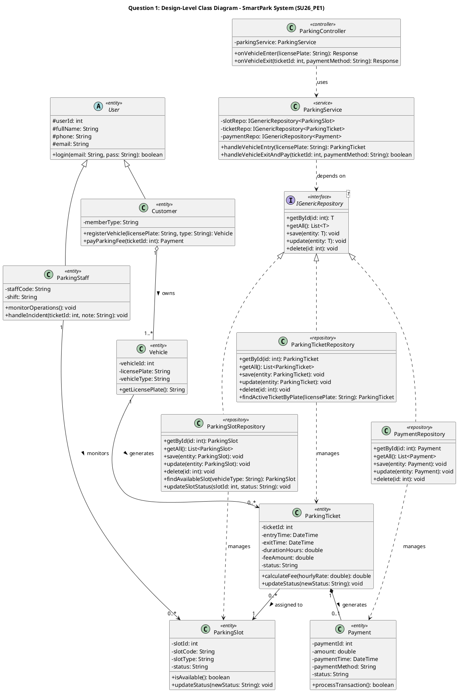

---

## C.2. SEQUENCE DIAGRAM (XUẤT HIỆN 10/10 ĐỀ – 4.0 ĐIỂM)

### 1. Bảng ký hiệu tối thiểu bắt buộc thuộc lòng

| STT | Ký hiệu | Hình dáng chuẩn UML 2.5 | Quy tắc bắt buộc khi chấm bài PE |
| :-: | :--- | :--- | :--- |
| **1** | **Khung `sd`** | Khung chữ nhật lớn bao ngoài cùng, góc trên trái ghi `sd [Tên Use Case]` | Luôn vẽ khung `sd` bao quanh sơ đồ. |
| **2** | **Lifelines** | Cột dọc nét đứt, trên đầu là Actor hoặc hộp `:TênClass` kèm stereotype (`«boundary»`, `«control»`, `«service»`, `«repository»`, `«entity»`) | Phải xếp từ trái qua phải đúng thứ tự tầng: `Actor` $\rightarrow$ `UI` $\rightarrow$ `Controller` $\rightarrow$ `Service` $\rightarrow$ `Repository` $\rightarrow$ `Entity/DB`. |
| **3** | **Sync Message** *(Gọi hàm)* | `———————▶` *(Nét liền, mũi tên đặc)* | Phải đánh số thứ tự (`1`, `2`, `3` hoặc `1`, `1.1`, `1.2`) và ghi rõ tên hàm `tênHàm(thamSố)`. |
| **4** | **Reply Message** *(Trả về)* | `< - - - - - - -` *(NÉT ĐỨT, mũi tên hở)* | Cứ có mũi tên gọi đi sang phải thì phải có mũi tên **nét đứt** trả kết quả về bên trái. |
| **5** | **Khung `alt`** *(Rẽ nhánh)* | Khung chữ nhật có nhãn `alt`, chia 2 ngăn bằng **đường kẻ ngang nét đứt**: Ngăn trên `[điều kiện đúng]`, ngăn dưới `[else: điều kiện sai]` | Mọi điều kiện phải nằm trong dấu ngoặc vuông **`[...]`**. |

---

### 2. Quy trình 5 bước vẽ Sequence Diagram cho cả Đề Mới & Đề Cũ

1. **Bước 1:** Kẻ 6–7 cột Lifelines từ trái sang phải: `Actor` $\rightarrow$ `:UI` (`«boundary»`) $\rightarrow$ `:Controller` (`«control»`) $\rightarrow$ `:Service` (`«service»`) $\rightarrow$ `:Repository` (`«repository»`) $\rightarrow$ `:Entity` (`«entity»`) / `Database`.
2. **Bước 2:**
   - **Nếu là Đề Cũ (`SU25`/`Fall25` có câu *"with authentication and authorization"*):** Trước khi gọi hàm nghiệp vụ, vẽ bước `:Controller` kiểm tra `verifyTokenAndRole(jwtToken)` (hoặc khung `alt [Authenticated & Authorized]` vs `[else: 401/403 Unauthorized]`).
   - **Nếu là Đề Mới (`SP26`, `FA26_Ex`, `SU26`):** Vẽ thẳng từ `Actor` $\rightarrow$ `:UI` $\rightarrow$ `:Controller` $\rightarrow$ `:Service`.
3. **Bước 3:** Từ `:Service`, gọi hàm kiểm tra trạng thái/chỗ trống xuống `:Repository` (ví dụ: `findAvailableSlot()`, `checkAvailability()`, `getById()`) và nhận kết quả nét đứt trả về.
4. **Bước 4:** Mở khung **`alt` số 1** (`[Available]` vs `[else: Not Available / Full]`).
5. **Bước 5:** Trong nhánh đúng của `alt` số 1, nếu đề có bước Thanh toán thì mở tiếp khung **`alt` số 2** (`[Payment Success]` $\rightarrow$ gọi `save()` và `updateStatus()` qua Repository; `[else: Payment Failed]` $\rightarrow$ trả lỗi về UI).

---

### 3. Ví dụ làm mẫu từ đề thật: `SU26_PE1` – SmartPark (`Vehicle Entry and Ticket Generation` – 4.0 điểm)

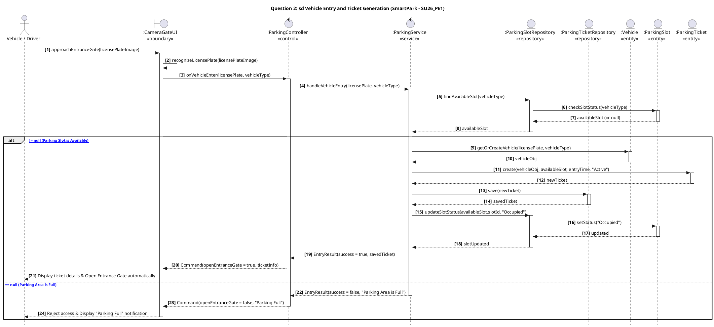

---

## C.3. STATECHART DIAGRAM (XUẤT HIỆN 8/10 ĐỀ – 1.5 ĐẾN 3.0 ĐIỂM)

### 1. Bảng 4 ký hiệu duy nhất của Statechart Diagram
1. **Initial State (`●`):** Chấm tròn đen đặc – điểm bắt đầu.
2. **State (Hình chữ nhật bo góc):** Trạng thái của đối tượng (Tên phải là **Tính từ / Phân từ** như `Pending`, `Confirmed`, `Active`, `Completed`, `Cancelled`).
3. **Transition (`───▶`):** Mũi tên chuyển trạng thái. Trên mũi tên **BẮT BUỘC ghi tên sự kiện** theo cú pháp: `tênSựKiện [điềuKiện] / hànhĐộng` (ví dụ: `paySuccess [valid] / confirmOrder()`).
4. **Final State (`◉`):** Chấm tròn đen có vòng tròn bao ngoài – điểm kết thúc.

### 2. Quy trình 4 bước vẽ Statechart Diagram ăn trọn điểm
1. **Bước 1:** Vẽ `●` nối mũi tên khởi tạo (ví dụ `createBooking` / `submitOrder`) vào trạng thái đầu tiên (`Pending` / `Draft` / `Registered`).
2. **Bước 2:** Nối dây chuyền các trạng thái chính theo luồng thành công từ đầu đến trạng thái hoàn tất (`Completed` / `Passed`).
3. **Bước 3:** Vẽ thêm **1–2 trạng thái kết thúc phụ** (`Cancelled`, `Rejected`, `PaymentFailed`, `Dropped`, `Failed`) và nối mũi tên rẽ nhánh từ các trạng thái ban đầu sang đó.
4. **Bước 4:** Đếm tổng số mũi tên chuyển trạng thái đảm bảo **$\ge 6$ mũi tên** (yêu cầu cứng của đề `SP26` và `SU26_PE2`), nối tất cả các trạng thái kết thúc (`Completed`, `Cancelled`, `Failed`) vào `◉`.

---

## C.4. ACTIVITY DIAGRAM CÓ SWIMLANES (XUẤT HIỆN Ở 50% ĐỀ MỚI – 3.0 ĐIỂM)

### 1. Bảng 5 ký hiệu duy nhất của Activity Diagram trong đề PE
1. **Swimlanes (Các cột dọc):** Chia bảng thành tối thiểu **2 cột** (`Customer` / `Host` và `System`).
2. **Initial Node (`●`):** Điểm bắt đầu (đặt ở đầu cột thứ nhất).
3. **Action Node (Hình chữ nhật bo góc):** Bước hành động (Tên bắt buộc bắt đầu bằng **Động từ**: `Inspect Room`, `Calculate Fee`, `Update Status`).
4. **Decision Node (`◇` Hình thoi):** Điểm kiểm tra điều kiện rẽ nhánh. Hai mũi tên đi ra từ hình thoi phải ghi rõ **`[Yes / Damage Found]`** và **`[No / No Damage]`**.
5. **Activity Final Node (`◉`):** Điểm kết thúc quy trình.

### 2. Ví dụ làm mẫu từ đề thật: `FA26_Example` – StayEase (`Check-out and Inspection` – 3.0 điểm)

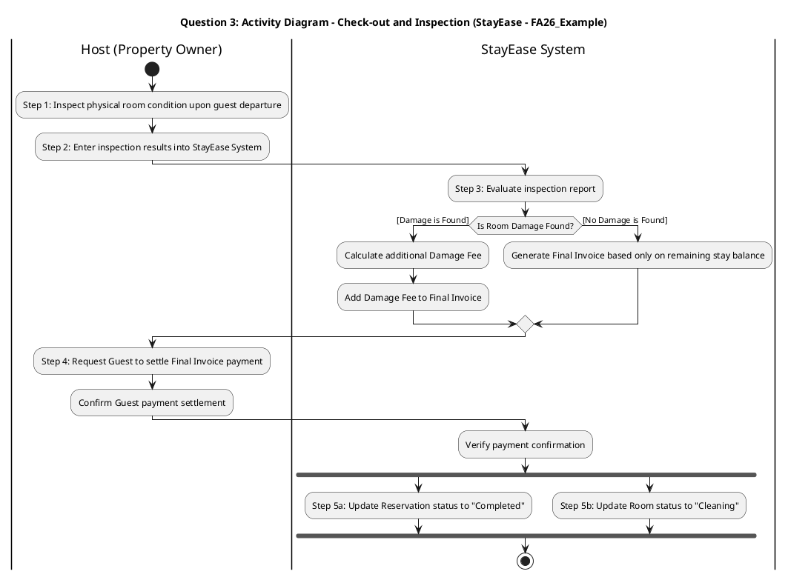

---

## C.5. ERD – CONCEPTUAL ERD & LOGICAL ERD (XUẤT HIỆN 4/10 ĐỀ – 2.5 ĐIỂM)

Trong 4 đề dạng 3 Parts (`SU25` Cinema, FlowerShop, StudentManagement và `Fall25` OnlineFood), Part 1 luôn hỏi liên tiếp 2 câu:
- **Câu 1.2 (1.0 điểm):** *"DRAW the conceptual ERD for the system."*
- **Câu 1.3 (1.5 điểm):** *"DRAW the logical ERD (with primary/foreign keys and basic data types)."*

### Bảng phân biệt rạch ròi để lấy trọn 2.5/2.5 điểm cả 2 câu:

| Tiêu chí | Câu 1.2: Conceptual ERD (1.0 điểm) | Câu 1.3: Logical ERD (1.5 điểm) |
| :--- | :--- | :--- |
| **Ký hiệu dùng** | **Chen's Notation** (Chữ nhật – Hình thoi – Bầu dục) hoặc **Crow's Foot** cơ bản. | **Crow's Foot** dạng bảng có 2 cột (`PK/FK` \| `Tên thuộc tính : Kiểu dữ liệu`). |
| **Khóa ngoại (`FK`)** | **TUYỆT ĐỐI KHÔNG GHI `FK`!** (Chỉ gạch chân thuộc tính định danh của mỗi thực thể). | **BẮT BUỘC GHI RÕ `PK` và `FK`** theo đúng yêu cầu đề. |
| **Kiểu dữ liệu (`int`, `varchar`...)** | **TUYỆT ĐỐI KHÔNG GHI KIỂU DỮ LIỆU!** | **BẮT BUỘC GHI KIỂU DỮ LIỆU CƠ BẢN** (`int`, `varchar(100)`, `decimal(10,2)`, `datetime`). |
| **Quan hệ Nhiều – Nhiều (`N - N`)** | Giữ nguyên mối quan hệ `M - N` trực tiếp giữa 2 thực thể (ví dụ: `Order` `M` — `N` `Dish`). | Tách quan hệ `N - N` thành **Thực thể kết hợp / Bảng trung gian** (ví dụ: `OrderDetail` chứa `orderId (FK)`, `dishId (FK)`, `quantity`, `unitPrice`). |

---

## C.6. USE CASE DIAGRAM (ĐỀ `SU25_CINEMA` – 1.5 ĐIỂM)

Chỉ cần nhớ đúng **3 quy tắc sống còn**:
1. **Không dùng từ `Manage ...` hoặc gộp CRUD:** Tách thành hành động cụ thể (`Browse Movies`, `Reserve Ticket Online`, `Create Movie Schedule`, `Update Seat Availability`).
2. **Có khung System Boundary:** Actor đứng ngoài khung, Use Case (hình bầu dục) nằm trong khung, nối giữa Actor và Use Case bằng **đường nét liền không mũi tên**.
3. **Chiều mũi tên `«include»` và `«extend»`:**
   - **`«include»` (Bắt buộc):** Mũi tên nét đứt chỉ từ **Use Case chính $\dashrightarrow$ Use Case bắt buộc đi kèm** (Ví dụ: `Reserve Ticket` $\dashrightarrow$ `«include»` $\dashrightarrow$ `Select Seat`).
   - **`«extend»` (Tùy chọn):** Mũi tên nét đứt chỉ từ **Use Case phụ/mở rộng $\dashrightarrow$ ngược về Use Case gốc** (Ví dụ: `Cancel Booking` $\dashrightarrow$ `«extend»` $\dashrightarrow$ `View Booking History`).

---

# PHẦN D. BỘ TEMPLATE MẪU (CHỈ GỒM CÁC CÂU HỎI ĐÃ RA THI – ĐIỀN LÀ DÙNG)

---

## D.1. TEMPLATE 1: CLASS DIAGRAM CHUẨN ĐỀ THI (KẾ THỪA `USER` + ENTITIES + REPOSITORY PATTERN)

> **Hướng dẫn điền nhanh trong phòng thi:** Chỉ cần thay các từ trong `<<...>>` bằng danh từ của đề thi hôm đó (không thêm các class thừa ngoài đề):
> - `<<Role1>>`, `<<Role2>>`, `<<Role3>>`: Các loại người dùng kế thừa từ `User`.
> - `<<Resource>>`: Thực thể tài nguyên (`Room` / `Event` / `ParkingSlot` / `DoctorSchedule`).
> - `<<MainTx>>`: Thực thể giao dịch chính (`Reservation` / `Registration` / `ParkingTicket` / `Appointment`).
> - `<<Payment>>`: Thực thể thanh toán (`Payment` - nếu đề có nhắc tới thanh toán).

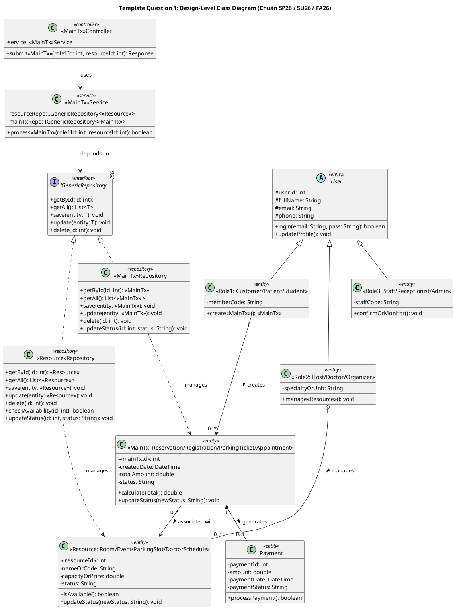

---

## D.2. TEMPLATE 2: SEQUENCE DIAGRAM CHUẨN ĐỀ THI (4.0 ĐIỂM)

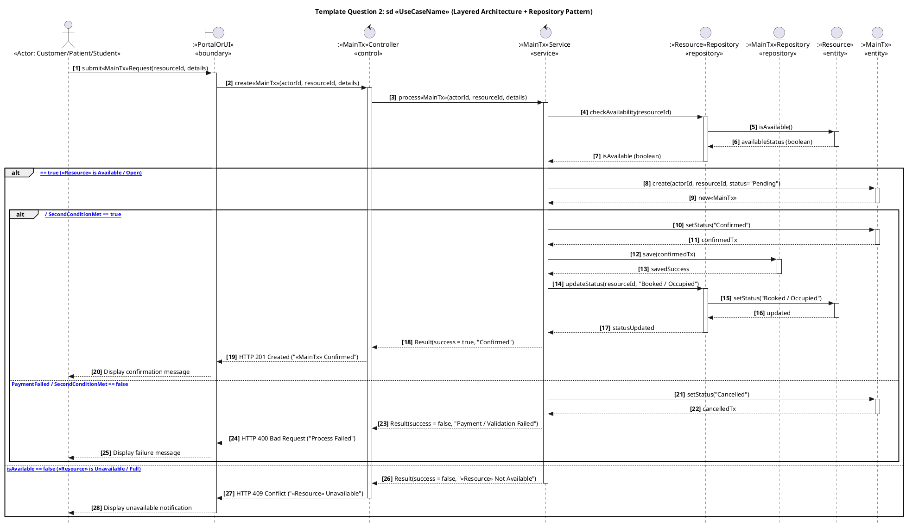
> **Lưu ý nhỏ nếu gặp Đề Cũ (`SU25`/`Fall25`) yêu cầu *"with authentication and authorization"*:**  
> Chỉ cần thêm 1 lời gọi tự thân hoặc gọi sang `:AuthMiddleware` ngay tại `:Controller` ở bước số 2: `verifyJwtTokenAndRole(token)` $\rightarrow$ trả về `isAuthorized = true` trước khi gọi sang `:Service`!

---

## D.3. TEMPLATE 3: STATECHART DIAGRAM & ACTIVITY DIAGRAM (CHUẨN CÂU 3 – 3.0 ĐIỂM)

### 1. Template Statechart Diagram (Khi Câu 3 hỏi Vòng đời Thực thể)
```plantuml
@startuml
title Template Question 3A: Statechart Diagram - <<EntityName>> Lifecycle

[*] --> <<State1: Pending / Draft>> : create<<EntityName>>

<<State1: Pending / Draft>> --> <<State2: Confirmed / Approved>> : confirmOrPaySuccess [valid]
<<State1: Pending / Draft>> --> <<FailState: PaymentFailed / Rejected>> : payFailOrReject [invalid]
<<State1: Pending / Draft>> --> Cancelled : cancel<<EntityName>> [by User]

<<State2: Confirmed / Approved>> --> <<State3: CheckedIn / OpenForRegistration>> : checkInOrOpen [on time]
<<State2: Confirmed / Approved>> --> Cancelled : cancel<<EntityName>> [before start]

<<State3: CheckedIn / OpenForRegistration>> --> <<State4: InConsultation / Ongoing>> : startExecution

<<State4: InConsultation / Ongoing>> --> Completed : finishExecution / saveOutcome()

<<FailState: PaymentFailed / Rejected>> --> [*]
Cancelled --> [*]
Completed --> [*]
@enduml
```

### 2. Template Activity Diagram 2 Swimlanes (Khi Câu 3 hỏi Quy trình Phối hợp)
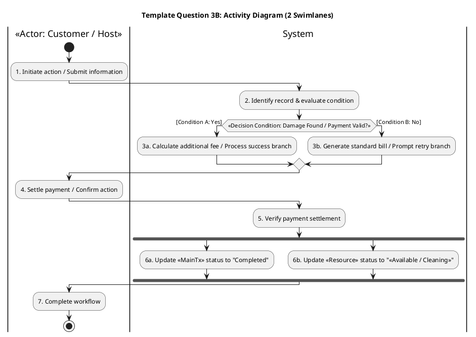

---

## D.4. TEMPLATE 4: ERD (CONCEPTUAL & LOGICAL) & USE CASE (CHO ĐỀ 3 PARTS `SU25`/`FALL25`)

### 1. Template Conceptual ERD (Câu 1.2 – Không FK, Không Data Types)
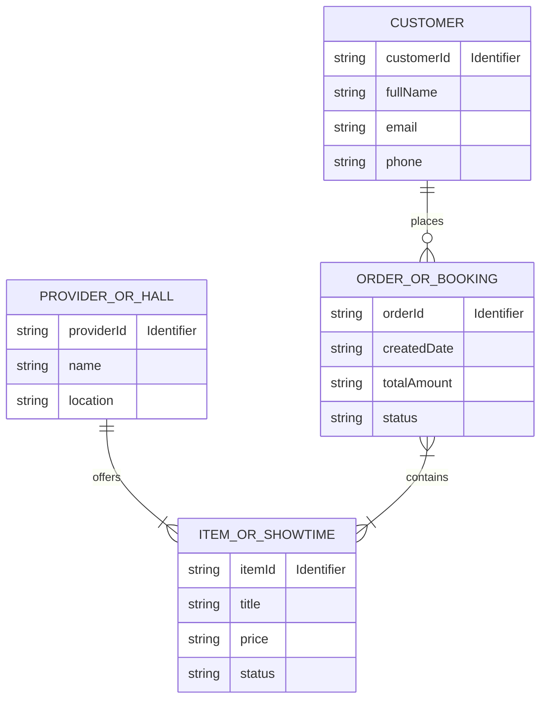

### 2. Template Logical ERD (Câu 1.3 – Có PK, FK, Basic Data Types & Bảng trung gian)
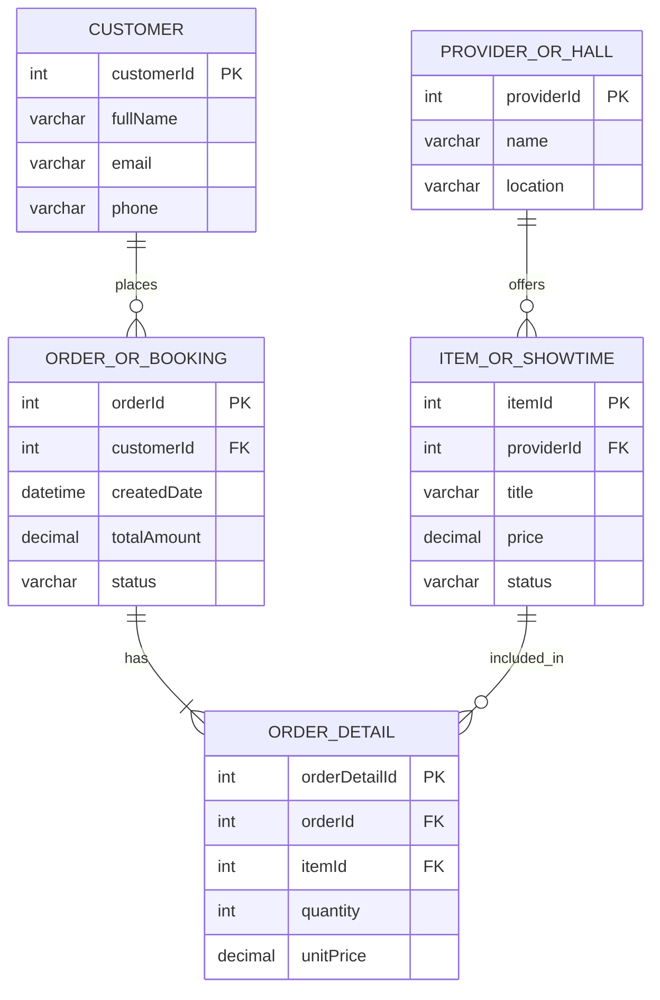

---

## D.5. TEMPLATE 5: ĐÚNG 5 DESIGN PATTERNS ĐÃ RA TRONG ĐỀ PE (KHÔNG HỌC THỪA!)

Trong toàn bộ 10 đề thi, chỉ có **đúng 5 Design Patterns** sau xuất hiện. Bạn chỉ cần thuộc lòng bảng này là giải quyết được 100% câu hỏi Pattern:

| STT | Tên Pattern & Họ (Family) | Đề đã ra | Dấu hiệu nhận biết trong đề (Nhìn 3 giây là biết) | Tình huống áp dụng thực tế (Viết vào câu 3.3) |
| :-: | :--- | :--- | :--- | :--- |
| **1** | **Observer Pattern**<br>*(Behavioral)* | • `SU25_Cinema`<br>• `SU25_CyberAI` | • Code có `List<Notification>`, `addNotification()`, `removeNotification()`, `notifyNotifications()` gọi vòng lặp `update()`.<br>• Đề chữ: Danh sách sinh viên chờ môn học (`Waitlist`), khi có ghế trống thì tự động thông báo cho tất cả người đăng ký. | Hệ thống thông báo thời gian thực khi có ghế trống, thay đổi lịch chiếu phim, hoặc thông báo biến động giá cổ phiếu/đơn hàng cho người theo dõi. |
| **2** | **Strategy Pattern**<br>*(Behavioral)* | • `SU25_FlowerShop` | • Code có `interface Pricing { calculatePrice(...) }`, nhiều class thực thi (`RegularPricing`, `SeasonalPricing`, `VIPPricing`), và lớp `FlowerOrder` có hàm `setPricing(Pricing p)`. | Tính tổng tiền đơn hàng/vé theo nhiều chính sách giá khác nhau (Khách thường, VIP, Khuyến mãi theo mùa) hoặc chọn phương thức tính phí giao hàng lúc thanh toán. |
| **3** | **Singleton Pattern**<br>*(Creational)* | • `SU25_Student`<br>• `SU25_Final` | • Đề chữ: *"create a new one -> get the one you already created"*, *"single, globally accessible object"*, *"one and only one instance"* (quản lý `SystemSettings` / `AppConfig`). | Quản lý cấu hình toàn cục của ứng dụng (`AppConfiguration`), quản lý `DatabaseConnectionPool`, hoặc bộ ghi nhật ký hệ thống (`Logger`). |
| **4** | **Decorator Pattern**<br>*(Structural)* | • `Fall25_Food` | • Code có `interface Dish`, `BasicDish`, và `abstract class DishDecorator implements Dish` chứa biến `protected Dish decoratedDish;`, các lớp con `CheeseDecorator`, `SauceDecorator` cộng dồn giá và mô tả. | Đặt đồ ăn/đồ uống có thêm nhiều loại Topping tùy chọn (Phô mai, Sốt, Trân châu) giúp cộng dồn giá tiền và mô tả linh hoạt mà không cần tạo hàng chục class con. |
| **5** | **Repository Pattern**<br>*(Architectural / Data Access)* | • `FA26_Example`<br>• `SP26`<br>• `SU26_PE1`<br>• `SU26_PE2` | • Đề yêu cầu: *"The Repository Pattern is mandatory"*, *"Repository classes must implement a generic interface IGenericRepository<T>"*. | Tách biệt hoàn toàn tầng Business Logic (`Service`) khỏi tầng truy cập CSDL (`Data Access`), giúp dễ dàng bảo trì, viết Unit Test và thay đổi hệ quản trị CSDL. |

### Sơ đồ Class Diagram chuẩn của 4 Pattern (Observer, Strategy, Decorator, Singleton) để vẽ vào Part 3:

```plantuml
@startuml
skinparam classAttributeIconSize 0
title 4 Design Patterns in Part 3 of SWD392 PE Exams

package "1. Observer Pattern (Behavioral - SU25 Cinema)" {
  interface Notification <<interface>> {
    + update(movieTitle: String, showTime: String, availableSeat: int): void
  }
  class ShowtimeSubject {
    - notifications: List<Notification>
    - movieTitle: String
    - showTime: String
    - availableSeat: int
    + addNotification(n: Notification): void
    + removeNotification(n: Notification): void
    + notifyNotifications(): void
    + updateShowtime(title: String, time: String, seat: int): void
  }
  class CustomerNotification {
    + update(movieTitle: String, showTime: String, availableSeat: int): void
  }
  ShowtimeSubject "1" o-- "0..*" Notification : notifies >
  Notification <|.. CustomerNotification
}

package "2. Strategy Pattern (Behavioral - SU25 FlowerShop)" {
  interface Pricing <<interface>> {
    + calculatePrice(basePrice: double, quantity: int, customerType: String): double
  }
  class RegularPricing {
    + calculatePrice(basePrice: double, quantity: int, customerType: String): double
  }
  class SeasonalPricing {
    + calculatePrice(basePrice: double, quantity: int, customerType: String): double
  }
  class VIPPricing {
    + calculatePrice(basePrice: double, quantity: int, customerType: String): double
  }
  class FlowerOrder {
    - pricing: Pricing
    + setPricing(p: Pricing): void
    + calculateOrderTotal(basePrice: double, quantity: int, customerType: String): double
  }
  FlowerOrder "1" o-- "1" Pricing : uses >
  Pricing <|.. RegularPricing
  Pricing <|.. SeasonalPricing
  Pricing <|.. VIPPricing
}

package "3. Decorator Pattern (Structural - Fall25 Food)" {
  interface Dish <<interface>> {
    + getDescription(): String
    + getCost(): double
  }
  class BasicDish {
    + getDescription(): String
    + getCost(): double
  }
  abstract class DishDecorator {
    # decoratedDish: Dish
    + DishDecorator(dish: Dish)
    + getDescription(): String
    + getCost(): double
  }
  class CheeseDecorator {
    + CheeseDecorator(dish: Dish)
    + getDescription(): String
    + getCost(): double
  }
  class SauceDecorator {
    + SauceDecorator(dish: Dish)
    + getDescription(): String
    + getCost(): double
  }
  Dish <|.. BasicDish
  Dish <|.. DishDecorator
  DishDecorator o-- "1" Dish : wraps >
  DishDecorator <|-- CheeseDecorator
  DishDecorator <|-- SauceDecorator
}

package "4. Singleton Pattern (Creational - SU25 Student & Final)" {
  class DatabaseConnection {
    - {static} instance: DatabaseConnection
    - DatabaseConnection()
    + {static} getInstance(): DatabaseConnection
    + executeQuery(sql: String): void
  }
}
@enduml
```

---

## D.6. TEMPLATE 6: VĂN MẪU TRẢ LỜI LÝ THUYẾT ARCHITECTURE & MỤC `BRIEF EXPLANATION`

### 1. Mẫu trả lời câu hỏi chọn Software Architecture (Câu 4 đề `SU25_CyberAI` & `SU25_Final` – 1.0 điểm)
Khi đề hỏi đề xuất kiến trúc cho hệ thống quản lý/web portal và nêu lý do + ưu/nhược điểm, bạn chép đúng đoạn sau:
> - **Selected Architecture:** **Layered Architecture (4-Tier Architecture: Presentation UI Layer, Controller/API Layer, Business Logic/Service Layer, and Data Access/Repository Layer)**.
> - **Reason for Selection:** It enforces a clean **separation of concerns**, allowing UI designers, backend engineers, and database administrators to develop and maintain their respective layers in parallel, while its standard structure allows new developers to understand the system quickly.
> - **Two Key Advantages:**
>   1. **High Maintainability & Testability:** Business logic in the Service layer is isolated from the UI and Database through the Repository interface.
>   2. **Parallel Development:** Different sub-teams can work simultaneously on UI, Service, and Database layers without blocking each other.
> - **One Key Disadvantage:**
>   1. **Performance Overhead:** Every request must traverse multiple layers sequentially before reaching the database.

---

### 2. Mẫu trả lời câu *"Describe the classes/tables used on the client side, server side (Controller, Service, Repository), and database"* (Part 2.1 đề `SU25_Student` & `Fall25_Food` – 1.0 điểm)
Khi đề không bắt vẽ Class Diagram ở câu 2.1 mà bảo **DESCRIBE** (mô tả chữ), bạn điền theo đúng khung 4 gạch đầu dòng này:
> 1. **Client Side (React UI):** `<<OrderBookingPage / SubjectRegistrationComponent>>` (renders the form, collects user input) and `<<OrderApiService>>` (sends HTTP POST request with JSON payload and JWT token to the server).
> 2. **Server Side – Controller Layer:** `<<OrderController>>` (`+ createOrder(requestDTO)` – receives HTTP POST request, validates input & JWT authorization, and calls Service layer).
> 3. **Server Side – Service & Repository Layer:**
>    - `<<OrderService>>`: Checks business rules (e.g., availability/stock/prerequisites), calculates total, and coordinates transaction.
>    - `<<OrderRepository>>` & `<<DishRepository>>`: Implement `IGenericRepository<T>` to execute CRUD operations (`getById()`, `save()`, `updateStatus()`).
> 4. **Database Tables (RDBMS):** Tables `<<Users>>`, `<<Orders>>`, `<<OrderDetails>>`, and `<<Dishes>>` storing persistent records with primary and foreign key constraints.

---

### 3. Văn mẫu điền mục `Brief Explanation:` trong phiếu nộp bài `_ID.docx` (Q1, Q2, Q3)

- **Dưới Question 1 (Class Diagram):**
  > **Brief Explanation:** The Class Diagram applies Layered Architecture with the mandatory Generic Repository Pattern (`<<Service>>` depends on `IGenericRepository<T>`, realized by concrete repositories). Role classes inherit shared attributes from the base `User` class via Generalization. Domain entities are connected with explicit multiplicities (`1`, `0..*`), using Composition (`*--`) where child records (e.g., `Payment`/`Registration`) cannot exist independently without their parent entity.
- **Dưới Question 2 (Sequence Diagram):**
  > **Brief Explanation:** The Sequence Diagram models the time-ordered interaction across the Layered Architecture (`Actor -> UI Boundary -> Controller -> Service -> Repositories -> Domain Entities`). Repository methods (`checkAvailability`, `save`, `updateStatus`) are explicitly invoked for data access, and `alt` combined fragments handle conditional branching for resource availability and payment/validation outcomes.
- **Dưới Question 3 (State Diagram hoặc Activity Diagram):**
  > **Brief Explanation:** The diagram models the complete lifecycle/workflow from the Initial Node to the Final Node. All required states/swimlanes, guard conditions (`[...]`), branching paths (including cancellation/failure handling), and entity status updates are explicitly represented in compliance with UML 2.5 standards.

---

# PHẦN E. LUYỆN TẬP THỰC CHIẾN (GIẢI MẪU ĐỀ THẬT + 3 ĐỀ MỚI + 18 LỖI PHỔ BIẾN)

---

## E.1. GIẢI MẪU TRỌN VẸN 2 ĐỀ THI THẬT (1 ĐỀ FORMAT MỚI + 1 ĐỀ FORMAT 3 PARTS)

---

### BÀI GIẢI MẪU SỐ 1: ĐỀ `SP26` – UNIVERSITY EVENT MANAGEMENT SYSTEM (EMS) (10.0 ĐIỂM)
**Nguồn đề:** `SP26/SWD392_SP26_EventManagementSystem_LêQuangĐạt.md`

#### Question 1 (3.0 points) – Design-Level Class Diagram

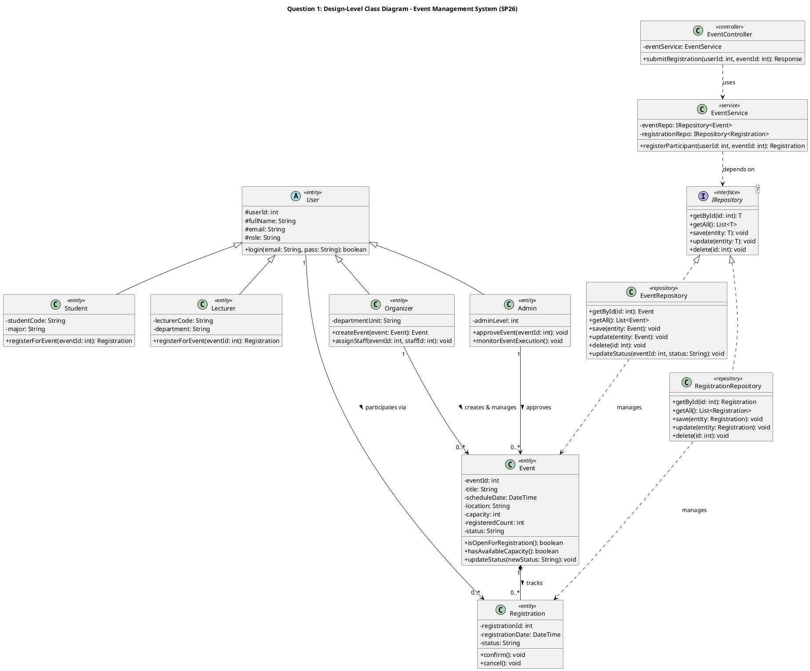

#### Question 2 (4.0 points) – Sequence Diagram: Use Case "Register for Event"

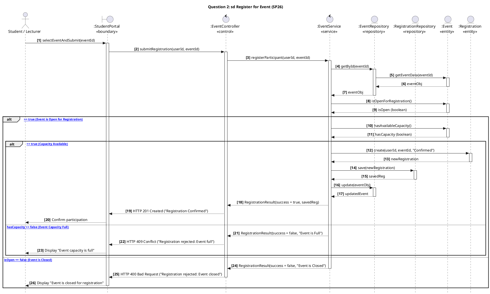

#### Question 3 (3.0 points) – State Diagram: Event Lifecycle Management

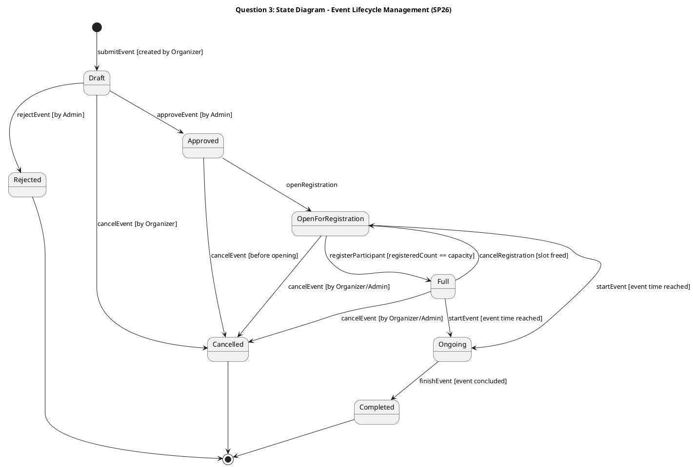

---

### BÀI GIẢI MẪU SỐ 2: ĐỀ `SU25` – FLOWER SHOP MANAGEMENT SYSTEM (FORMAT 3 PARTS – 10.0 ĐIỂM)
**Nguồn đề:** `SU25/SWD392_FlowerShop_PracticalExam_LêQuangĐạt.md`

#### Part 1: Data Analysis and Design (5.0 points)
- **1.1 List Primary Entities & Key Attributes (1.0 pt):**
  1. `Customer`: `customerId`, `fullName`, `email`, `phone`, `customerType` (regular, VIP), `address`.
  2. `Category`: `categoryId`, `categoryName` (fresh flowers, artificial flowers, seasonal arrangements), `description`.
  3. `Flower`: `flowerId`, `flowerName`, `flowerType` (premium, standard, budget), `color`, `seasonalAvailability`, `careInstructions`, `basePrice`, `stockQuantity`.
  4. `Order`: `orderId`, `orderDate`, `arrangementComplexity` (simple bouquet, elaborate, wedding package), `deliveryOption` (same-day, next-day, scheduled), `totalAmount`, `status`.
  5. `Payment`: `paymentId`, `paymentDate`, `amount`, `paymentMethod`, `status`.
- **1.2 Conceptual ERD (1.0 pt):** Vẽ theo Template D.4.1 (Nối `Customer` `1—N` `Order`, `Category` `1—N` `Flower`, `Order` `M—N` `Flower`, `Order` `1—1` `Payment`; **không ghi FK, không ghi kiểu dữ liệu**).
- **1.3 Logical ERD (1.5 pts):** Vẽ theo Template D.4.2 (Tách quan hệ `M—N` giữa `Order` và `Flower` thành bảng `OrderDetail` có `orderId (FK)`, `flowerId (FK)`, `quantity`, `unitPrice`; bổ sung `PK`, `FK` và kiểu dữ liệu `int`, `varchar`, `decimal`, `datetime`).
- **1.4 Main States & State Diagram for `Order` (1.5 pts):**
  - States: `Pending`, `Confirmed`, `Arranging` (Preparing Bouquet), `OutForDelivery`, `Delivered` (Completed), `Cancelled`.
  - Transitions: `[*] -> Pending (placeOrder)`, `Pending -> Confirmed (paySuccess)`, `Pending -> Cancelled (cancelOrder)`, `Confirmed -> Arranging (assignStaff)`, `Arranging -> OutForDelivery (dispatchOrder)`, `OutForDelivery -> Delivered (confirmDelivery)`, `Delivered -> [*]`, `Cancelled -> [*]`.

#### Part 2: REST API Function Design for "create order" (3.0 points)
- **2.1 Class Diagram (1.5 pts) & 2.2 Sequence Diagram with Authentication & Authorization (1.5 pts):**
  - `Customer` $\rightarrow$ `OrderFormUI (React)` $\rightarrow$ `OrderController` (gọi `JwtAuthFilter.verifyTokenAndRole()` kiểm tra đăng nhập) $\rightarrow$ `OrderService` (gọi `FlowerRepository.checkStock()`, tính tiền, gọi `OrderRepository.save()`, gọi `FlowerRepository.deductStock()`) $\rightarrow$ `Database`.

#### Part 3: Design Pattern Identification and Analysis (2.0 points)
- **3.1 Name & Family (0.5 pts):** **Strategy Pattern** — **Behavioral Design Pattern** family.
- **3.2 Class Diagram (1.0 pt):** Vẽ đúng sơ đồ `Pricing` $\triangleleft\cdots$ (`RegularPricing`, `SeasonalPricing`, `VIPPricing`) và `FlowerOrder` `o--` `Pricing` (như tại Mục D.5).
- **3.3 Practical Situation (0.5 pts):** Used in an e-commerce checkout system where the order total calculation algorithm varies dynamically at runtime based on customer membership tier (Regular, VIP), seasonal promotion campaigns, or shipping fee strategies.

---

## E.2. BA ĐỀ TỰ LUYỆN MỚI (BÁM SÁT 100% CẤU TRÚC ĐỀ THẬT – ĐÁP ÁN Ở CUỐI FILE)

### 📝 ĐỀ LUYỆN TẬP SỐ 1 (Format Mới – Có Activity Diagram ở Câu 3): SPORTHUB – SPORTS COURT BOOKING
- **Question 1 (3.0 pts) – Design-level Class Diagram:**
  - `User` là lớp cha; `Player`, `FacilityManager`, `Admin` kế thừa từ `User`.
  - `FacilityManager` quản lý nhiều `SportsCourt` (`1` to `0..*`).
  - `Player` tạo nhiều `CourtBooking` (`1` to `0..*`), mỗi `CourtBooking` đặt đúng 1 `SportsCourt` (`0..*` to `1`).
  - Mỗi `CourtBooking` chứa `1..*` `Payment` (Composition – `Payment` không tồn tại nếu không có `CourtBooking`).
  - `CourtBookingService` phụ thuộc vào `IGenericRepository<T>`, được thực thi bởi `SportsCourtRepository` và `CourtBookingRepository`.
- **Question 2 (4.0 pts) – Sequence Diagram ("Book Sports Court"):**
  - Đi qua `Player` $\rightarrow$ `CourtBookingUI` $\rightarrow$ `CourtBookingController` $\rightarrow$ `CourtBookingService` $\rightarrow$ `Repositories` & `PaymentService` $\rightarrow$ `Entities`.
  - Khung `alt` 1: Kiểm tra sân trống (`[Court Available]` vs `[else: Court Occupied]`).
  - Khung `alt` 2: Kiểm tra thanh toán phí đặt sân (`[Payment Success]` $\rightarrow$ lưu `CourtBooking` và đổi trạng thái `SportsCourt` thành `"Reserved"` vs `[else: Payment Failed]`).
- **Question 3 (3.0 pts) – Activity Diagram ("Post-Match Court Inspection and Check-out"):**
  - 2 Swimlanes: `FacilityManager` và `SportHub System`.
  - `FacilityManager` kiểm tra sân sau trận đấu và nhập kết quả. `System` dùng **Decision Node** kiểm tra có hư hỏng dụng cụ/sân không: nếu có thì tính thêm phí đền bù; nếu không thì xuất hóa đơn thường. Sau khi thanh toán xong, cập nhật `CourtBooking = "Completed"` và `SportsCourt = "Available"`.

---

### 📝 ĐỀ LUYỆN TẬP SỐ 2 (Format Mới – Có State Diagram ở Câu 3): LIBSMART – UNIVERSITY LIBRARY SYSTEM
- **Question 1 (3.0 pts) – Design-level Class Diagram:**
  - `User` là lớp cha; `Student`, `Lecturer`, `Librarian` kế thừa từ `User`.
  - Một đầu sách `Book` có nhiều cuốn sách vật lý `BookCopy` (`1` to `1..*`, Composition).
  - Người mượn tạo nhiều phiếu mượn `LoanRecord` (`1` to `0..*`), mỗi `LoanRecord` gắn với 1 `BookCopy` (`0..*` to `1`) và có `0..1` `FinePayment` (tiền phạt quá hạn).
  - `LoanService` phụ thuộc vào `IRepository<T>`, được thực thi bởi `BookCopyRepository` và `LoanRepository`.
- **Question 2 (4.0 pts) – Sequence Diagram ("Borrow Book Copy"):**
  - Khung `alt` 1: Kiểm tra người mượn có nợ phí phạt quá hạn chưa đóng không (`[No Unpaid Fine]` vs `[else: Blocked by Unpaid Fine]`).
  - Khung `alt` 2: Kiểm tra cuốn sách `BookCopy` có đang `"Available"` không (`[Copy Available]` $\rightarrow$ tạo `LoanRecord`, lưu qua `LoanRepository.save()`, cập nhật `BookCopy` thành `"Borrowed"` vs `[else: Copy Unavailable]`).
- **Question 3 (3.0 pts) – State Diagram (`LoanRecord` Lifecycle):**
  - Các trạng thái bắt buộc: `Reserved`, `Approved`, `Borrowed`, `Overdue`, `Returned`, cộng thêm `Cancelled` và `Rejected`.
  - Tối thiểu 6 transitions có ghi rõ trigger event (`submitReservation`, `approveLoan`, `rejectLoan`, `cancelReservation`, `pickUpBook`, `dueDateExpired`, `returnBookOnTime`, `payFineAndReturnBook`).

---

### 📝 ĐỀ LUYỆN TẬP SỐ 3 (Format 3 Parts – Có ERD, Use Case & Design Pattern Code): FITLIFE GYM BOOKING
- **Part 1 (5.0 pts):** Hệ thống đặt lịch tập Gym với Huấn luyện viên cá nhân (`Member`, `GymBranch`, `Trainer`, `TrainingSession`, `Payment`):
  - **1.1 (1.0 pt):** Liệt kê các Entities và Key Attributes.
  - **1.2 (1.0 pt):** Vẽ **Conceptual ERD** (không FK, không kiểu dữ liệu).
  - **1.3 (1.5 pts):** Vẽ **Use Case Diagram** cho `Member` và `Trainer`.
  - **1.4 (1.5 pts):** Vẽ **State Diagram** cho `TrainingSession`.
- **Part 2 (3.0 pts):** Chức năng *"book training session"* (Client React + Server REST API MVC + DB):
  - **2.1 (1.5 pts):** Vẽ **Class Diagram** thiết kế chi tiết.
  - **2.2 (1.5 pts):** Vẽ **Sequence Diagram** có kiểm tra Authentication & Authorization.
- **Part 3 (2.0 pts):** Cho đoạn code `WorkoutPlan`, `StandardWorkout`, `WorkoutAddonDecorator`, `SaunaAccessAddon`, `NutritionCoachingAddon` $\rightarrow$ (3.1) Gọi tên Pattern & Family (0.5đ), (3.2) Vẽ Class Diagram của Pattern (1.0đ), (3.3) Nêu tình huống thực tế (0.5đ).

---

## E.3. DANH SÁCH 18 LỖI PHỔ BIẾN NHẤT TRONG ĐỀ THI & CÁCH SỬA NGAY

| STT | Loại câu | Lỗi sinh viên hay bị trừ điểm | Điểm trừ | Cách sửa đúng chuẩn 100% |
| :-: | :---: | :--- | :---: | :--- |
| **1** | **Class** | Nối `Repository` lên `IGenericRepository<T>` bằng **nét liền** | **-0.5đ** | Thực thi Interface (**Realization**) bắt buộc dùng **NÉT ĐỨT + Tam giác rỗng** (`..|>`). |
| **2** | **Class** | Vẽ ngược mũi tên kế thừa (từ `User` chỉ xuống `Customer`) | **-0.5đ** | Mũi tên **Inheritance** phải chỉ **từ Lớp Con lên Lớp Cha (`User`)**. |
| **3** | **Class** | Đặt hình thoi đen (Composition) ở đầu lớp phụ (`Payment`) thay vì lớp chính (`Reservation`) | **-0.25đ** | Hình thoi đen (`◆`) luôn gắn sát vào **Lớp Mẹ / Lớp Chính** (`Reservation ◆—— Payment`). |
| **4** | **Class** | Quên ghi **Multiplicity** (`1`, `0..*`, `1..*`, `0..1`) ở 2 đầu dây nối Entity | **-0.5đ** | Luôn kiểm tra mọi đường nối giữa các Entity đều có số ở cả 2 đầu. |
| **5** | **Class** | Quên ghi dấu `-` trước thuộc tính và `+` trước phương thức | **-0.25đ** | Mọi attribute ghi `- tên: Kiểu`, mọi method ghi `+ tênHàm(): Kiểu`. |
| **6** | **Class** | Nối Association Class (`GradeReport`) bằng nét liền | **-0.5đ** | Dùng đường **NÉT ĐỨT không mũi tên** nối vào chính giữa đường thẳng N–N. |
| **7** | **Sequence** | Cho `Actor` hoặc `UI` gọi thẳng vào `Repository` hoặc `Database` | **-1.0đ** | Phải đi đúng thứ tự tầng: `Actor -> UI -> Controller -> Service -> Repository -> Entity`. |
| **8** | **Sequence** | Vẽ mũi tên trả kết quả (Reply message) bằng **nét liền** | **-0.5đ** | Mũi tên trả về bắt buộc là **NÉT ĐỨT + mũi tên hở** (`< - - -`). |
| **9** | **Sequence** | Thiếu khung `alt` hoặc quên vẽ nhánh `[else]` khi hết chỗ / lỗi thanh toán | **-0.75đ** | Luôn vẽ khung `alt` có đường kẻ ngang nét đứt chia đôi nhánh đúng và nhánh `[else]`. |
| **10** | **Sequence** | Quên dấu ngoặc vuông `[...]` quanh điều kiện trong khung `alt` | **-0.25đ** | Luôn viết điều kiện trong ngoặc vuông: `[isAvailable == true]`. |
| **11** | **Sequence** | Không ghi rõ lời gọi hàm của Repository (`getById`, `save`, `updateStatus`) | **-0.5đ** | Ghi rõ tên hàm gọi vào `:XxxRepository` theo yêu cầu *"Repository Pattern usage must be explicit"*. |
| **12** | **State** | Vẽ mũi tên nối các trạng thái nhưng **quên ghi tên sự kiện (event)** trên mũi tên | **-1.0đ** | Trên mỗi mũi tên bắt buộc có chữ (ví dụ: `approveEvent`, `paySuccess`, `cancel`). |
| **13** | **State** | Đặt tên trạng thái bằng động từ (`Pay Money`, `Create Order`) | **-0.5đ** | Đặt tên trạng thái bằng **Tính từ / Phân từ** (`Pending`, `Confirmed`, `Completed`, `Cancelled`). |
| **14** | **State** | Thiếu trạng thái hủy/lỗi (`Cancelled`, `Rejected`, `PaymentFailed`) hoặc vẽ $< 6$ mũi tên | **-0.5đ** | Luôn vẽ thêm trạng thái `Cancelled`/`Failed` và đảm bảo tổng số mũi tên $\ge 6$. |
| **15** | **Activity** | Không kẻ bảng chia **2 cột Swimlanes** (`Customer/Host` và `System`) | **-1.0đ** | Luôn tạo 2 cột Swimlanes trước khi vẽ các hành động. |
| **16** | **Activity** | Rẽ nhánh trực tiếp từ hộp chữ nhật Action mà không qua hình thoi **Decision Node** | **-0.5đ** | Mọi chỗ rẽ nhánh điều kiện phải đi qua hình thoi `◇` có nhãn `[Yes]` / `[No]`. |
| **17** | **ERD** | Viết `FK` và kiểu dữ liệu (`int`, `varchar`) vào **Conceptual ERD** | **-0.5đ** | Câu 1.2 (Conceptual ERD) tuyệt đối không ghi FK và kiểu dữ liệu; chỉ ghi ở Câu 1.3 (Logical ERD). |
| **18** | **Use Case & Nộp bài** | Vẽ ngược mũi tên `«include»`/`«extend»`, dùng từ `Manage...`, hoặc bỏ trống **`Brief Explanation:`** | **-0.5đ** | `include` thuận chiều, `extend` ngược chiều; luôn điền 3 câu vào mục `Brief Explanation` trong file Word. |

---

# PHẦN F. NỘI QUY PHÒNG THI PEA & CHIẾN THUẬT LÀM BÀI AN TOÀN TUYỆT ĐỐI

## 1. Bảng Nội Quy Bắt Buộc Khi Thi Thực Hành (PEA) Môn SWD392

| Hạng mục | Quy định chính thức của Nhà trường | Hành động BẮT BUỘC bạn phải làm để không bị lập biên bản (0 điểm) |
| :--- | :--- | :--- |
| **1. Phần mềm ĐƯỢC PHÉP mở** | Chỉ được mở: **PEA Client**, **Microsoft Word**, **Draw.io Desktop (offline)**, **Visual Paradigm (offline)**, **PlantUML (offline)**, **Microsoft Visio**, **StarUML**. | **CHỈ MỞ ĐÚNG 3 CỬA SỔ:** (1) Phần mềm thi **PEA**, (2) **Microsoft Word**, (3) **Draw.io Desktop**. Tuyệt đối không mở trình duyệt web hay trình soạn thảo code! |
| **2. Tài liệu ĐƯỢC PHÉP dùng** | **Được phép dùng:** Tài liệu in (tài liệu giấy) VÀ **Tài liệu offline lưu trữ trên máy tính cá nhân**. | **LƯU Ý SỐNG CÒN:** Để đọc tài liệu offline trên máy trong lúc thi mà không vi phạm phần mềm cấm, bạn **PHẢI mở tài liệu bằng Microsoft Word (`.docx`) và mở template bằng Draw.io Desktop (`.drawio`)**. **TUYỆT ĐỐI KHÔNG mở file `.md` bằng VS Code, Cursor, Antigravity hay trình duyệt Chrome/Edge** vì đó là công cụ có AI / trình duyệt bị cấm! |
| **3. CẤM Chụp ảnh màn hình** | **Nghiêm cấm chụp ảnh màn hình trong quá trình thi** (`PrtSc`, `Win + Shift + S`, `Snipping Tool`, `Lightshot`...). | Khi vẽ xong trên Draw.io Desktop, **CẤM bấm `Win + Shift + S` để chụp hình dán vào Word!**<br>👉 **Cách làm đúng chuẩn hợp lệ 100%:** Trên Draw.io, bấm **`File` $\rightarrow$ `Export as` $\rightarrow$ `PNG...`** (chọn Zoom `150%` hoặc `200%`) $\rightarrow$ Lưu thành file ảnh `.png` $\rightarrow$ Sang Word bấm **`Insert` $\rightarrow$ `Pictures` $\rightarrow$ `This Device...`** để chèn ảnh vào! |
| **4. CẤM Phần mềm chạy ngầm (Kể cả ở System Tray)** | Ngay cả khi các phần mềm cấm **chỉ đang chạy nền và chưa sử dụng**, sinh viên vẫn bị tính là **VI PHẠM quy chế thi**! | **15 phút trước giờ thi, bấm `Ctrl + Shift + Esc` mở `Task Manager` và kiểm tra góc phải dưới màn hình (System Tray) để `End Task` / `Exit` sạch sẽ 5 nhóm sau:**<br>1. **Công cụ AI & IDE:** Antigravity, VS Code, Cursor, GitHub Copilot, ChatGPT Desktop, Claude...<br>2. **Ứng dụng nhắn tin:** Zalo, Messenger, Telegram, Discord, Viber, Skype.<br>3. **Ứng dụng đồng bộ đám mây:** **OneDrive** (rất hay tự chạy ngầm trên Windows!), Dropbox, Google Drive, Git Desktop.<br>4. **Điều khiển từ xa & Chụp màn hình:** UltraViewer, TeamViewer, AnyDesk, Lightshot, Snagit.<br>5. **Máy ảo & Trình duyệt:** VMware, VirtualBox, Docker Desktop, Chrome, Edge, Cốc Cốc, Brave (tắt cả chế độ chạy nền của trình duyệt). |
| **5. Quy tắc Đặt tên File / Folder nộp bài** | • Nộp 1 file Word (`.doc`/`.docx`) hoặc 1 file nén (`.rar`) theo đúng template.<br>• **Không dùng tên hoặc mã sinh viên khi đặt tên file/folder bài làm, TRỪ KHI đề yêu cầu.** | Đọc kỹ dòng **Submission Requirements** trong đề thi:<br>• Nếu đề yêu cầu giữ nguyên template tải từ PEA (không ghi tên/MSSV) $\rightarrow$ tuyệt đối không tự ý thêm tên mình vào!<br>• Nếu đề ghi rõ mẫu `SWD392_PE_..._[StudentID].docx` $\rightarrow$ đặt đúng theo mẫu của đề đó. |
| **6. Kiểm tra thẩm định (Phỏng vấn sau thi)** | Nếu điểm quá trình và điểm PE chênh lệch bất thường, sinh viên có thể được gọi **phỏng vấn thẩm định** để xác minh mức độ hiểu bài. | Khi dùng Template để vẽ, bạn phải nắm rõ bản chất: Tại sao dùng mũi tên nét đứt ở `IGenericRepository` (vì là *Realization* thực thi interface), tại sao dùng hình thoi đen ở `Payment` (vì là *Composition*), và luồng `alt` trong Sequence chạy như thế nào. |

---

## 2. Quy trình 85–90 Phút Làm Bài Đạt 9–10 Điểm Trong Phòng Thi

1. **Trước khi mở PEA (5 phút trước giờ thi):**
   - Tắt Wi-Fi / chỉ kết nối mạng LAN phòng thi theo hướng dẫn giám thị; mở `Task Manager` tắt sạch **OneDrive, Zalo, Chrome/Edge, VS Code, Antigravity, UltraViewer, VMware**.
   - Mở sẵn **Microsoft Word** (mở file tài liệu ôn tập `.docx`) và **Draw.io Desktop** (mở sẵn file `00_SWD392_PE_ALL_IN_ONE_TEMPLATES.drawio`).
2. **Phút 00 – 05 (Mở PEA & Chuẩn bị file nộp bài):**
   - Tải đề và file template bài làm từ **PEA**. Kiểm tra kỹ quy định đặt tên file (tuyệt đối không tự ghi tên/MSSV nếu đề không yêu cầu).
3. **Phút 05 – 20 (Làm Question 3 trước – 15 phút ăn chắc 3.0 điểm):**
   - Chuyển sang Tab 3 (`Statechart`) hoặc Tab 4 (`Activity Swimlanes`) trên file Template Draw.io, sửa tên các trạng thái/bước hành động theo đúng đề bài.
4. **Phút 20 – 45 (Làm Question 1: Class Diagram – 25 phút ăn 3.0 điểm):**
   - Chuyển sang Tab 1 (`Class Diagram`) trên Draw.io, thay tên các lớp kế thừa từ `User`, các `Entity`, và các lớp `Service` / `Repository` theo đúng bảng tra cứu.
5. **Phút 45 – 75 (Làm Question 2: Sequence Diagram – 30 phút ăn 4.0 điểm):**
   - Chuyển sang Tab 2 (`Sequence Diagram`), thay tên 7 Lifelines khớp 100% với tên class ở Câu 1, điền điều kiện cho 2 khung `alt`.
6. **Phút 75 – 85 (Xuất ảnh PNG bằng `File -> Export as -> PNG` + Điền `Brief Explanation` + Nộp PEA):**
   - **Nhớ:** Không dùng phím chụp màn hình! Dùng **`File -> Export as -> PNG...`** trên Draw.io rồi **`Insert -> Pictures`** vào file Word nộp bài.
   - Gõ 3 dòng `Brief Explanation` dưới mỗi hình, bấm `Ctrl + S`, đóng file Word rồi mới nộp lên **PEA**!

---

# PHẦN G. CHEAT SHEET 1 TRANG (ĐỌC TRƯỚC GIỜ VÀO PHÒNG THI)

```text
====================================================================================================
                    TỜ PHAO CỨU SINH 1 TRANG - SWD392 PE (CHỈ NHỮNG GÌ THI THẬT)
====================================================================================================

1. CLASS DIAGRAM (QUESTION 1 - 3.0 ĐIỂM)
   • Ngăn giữa (Attributes): Luôn có dấu [-] (hoặc [#] ở lớp cha User). VD: - roomId: int
   • Ngăn dưới (Methods):    Luôn có dấu [+]. VD: + isAvailable(): boolean
   • 6 Mũi tên chuẩn UML 2.5:
     (1) Inheritance (Kế thừa):    Role ─────────▷ User          (Nét liền + Tam giác RỖNG chỉ về User)
     (2) Realization (Interface):  Repo - - - - -▷ IGenericRepo  (NÉT ĐỨT + Tam giác RỖNG chỉ về Interface)
     (3) Dependency (Phụ thuộc):   Service - - - > IGenericRepo  (NÉT ĐỨT + Mũi tên HỞ)
     (4) Association (Liên kết):   Customer 1 ─── 0..* Booking   (Nét liền, BẮT BUỘC ghi số ở 2 đầu!)
     (5) Aggregation (Tập hợp):    Department 1 ◇── 1..* Prof    (Hình thoi RỖNG gắn ở lớp lớn; xóa không mất)
     (6) Composition (Sống chết):  Booking 1 ◆──── 1..* Payment  (Hình thoi ĐẶC gắn ở lớp mẹ; xóa mẹ mất con)
     (*) Association Class:        Đường NÉT ĐỨT không mũi tên nối vào chính giữa đường thẳng N-N.

2. SEQUENCE DIAGRAM (QUESTION 2 - 4.0 ĐIỂM)
   • Thứ tự cột: [Actor] -> [«boundary» :UI] -> [«control» :Controller] -> [«service» :Service] -> [«repository» :Repo] -> [«entity» :Entity]
   • Gọi hàm đi:  1: checkAvailability(id) ────────────▶ (Nét liền, đầu mũi tên đặc)
   • Trả kết quả: 2: isAvailable = true    ◀- - - - - -  (NÉT ĐỨT, đầu mũi tên hở)
   • Bắt buộc có 2 khung [alt]:
     - alt 1: [Resource is Available / Open]  ---(nét đứt ngang)---  [else: Resource Full / Closed]
     - alt 2: [Payment / Condition Succeeded] ---(nét đứt ngang)---  [else: Payment Failed]

3. STATE DIAGRAM & ACTIVITY DIAGRAM (QUESTION 3 - 3.0 ĐIỂM)
   • State Diagram:    (●) ──create──▶ [Pending/Draft] ──event [guard]──▶ [Confirmed] ──finish──▶ [Completed] ──▶ (◉)
                       Nhớ: MỌI mũi tên phải có tên sự kiện! Phải có nhánh rẽ sang [Cancelled / Failed] ──▶ (◉). (Tổng >= 6 mũi tên).
   • Activity Diagram: Chia 2 cột dọc Swimlanes: | Customer / Host | System |.
                       Rẽ nhánh phải qua Hình thoi (◇ Decision Node) có ghi [Yes] / [No].
                       Cuối bài nhớ cập nhật trạng thái cho CẢ 2 thực thể (VD: Reservation="Completed" & Room="Cleaning").

4. ERD & USE CASE & 5 DESIGN PATTERNS (CHO ĐỀ 3 PARTS SU25 / FALL25)
   • Conceptual ERD (Câu 1.2): KHÔNG ghi FK, KHÔNG ghi kiểu dữ liệu, giữ nguyên N-N, gạch chân khóa chính.
   • Logical ERD    (Câu 1.3): Ghi rõ PK, FK, kiểu dữ liệu (int, varchar, decimal) và tách N-N thành bảng trung gian.
   • Use Case: Không dùng từ "Manage...". «include»: Chính - - -> Phụ (thuận). «extend»: Phụ - - -> Chính (ngược).
   • 5 Design Patterns duy nhất trong đề:
     1. Có List<Notification> + add/remove + notify() -> update() / Waitlist  ==> OBSERVER (Behavioral)
     2. Có interface Pricing + Regular/Seasonal/VIP + setPricing(Pricing p)   ==> STRATEGY (Behavioral)
     3. Có private static instance + private Constructor + getInstance()      ==> SINGLETON (Creational)
     4. Có abstract class DishDecorator implements Dish bọc decoratedDish     ==> DECORATOR (Structural)
     5. Có IGenericRepository<T> tách biệt Service và Data Access             ==> REPOSITORY PATTERN
====================================================================================================
```

---

# PHỤ LỤC: ĐÁP ÁN MẪU CHI TIẾT CHO 3 ĐỀ TỰ LUYỆN (PHẦN E.2)

## 1. ĐÁP ÁN ĐỀ LUYỆN TẬP SỐ 1: SPORTHUB (CLASS + SEQUENCE + ACTIVITY)

### Question 1 (3.0 pts) – Design-Level Class Diagram (`SportHub`)
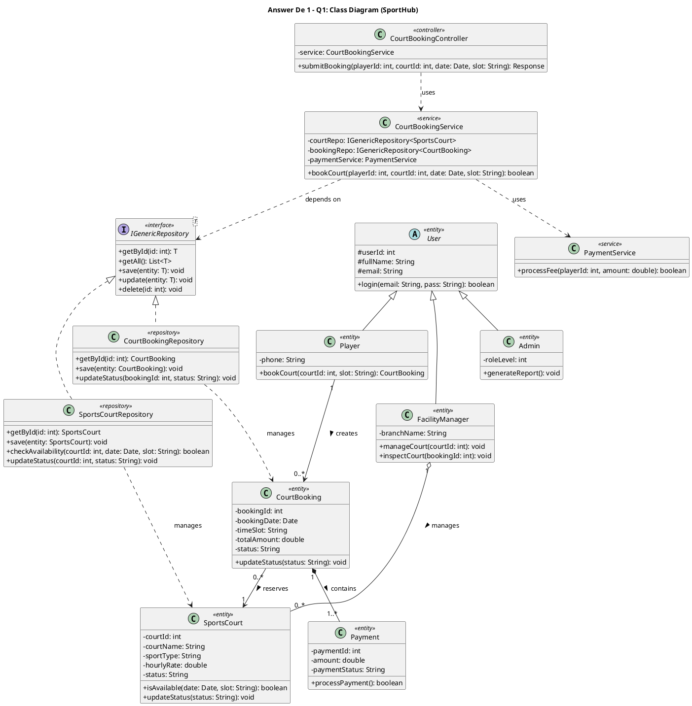

### Question 2 (4.0 pts) – Sequence Diagram (`Book Sports Court`)
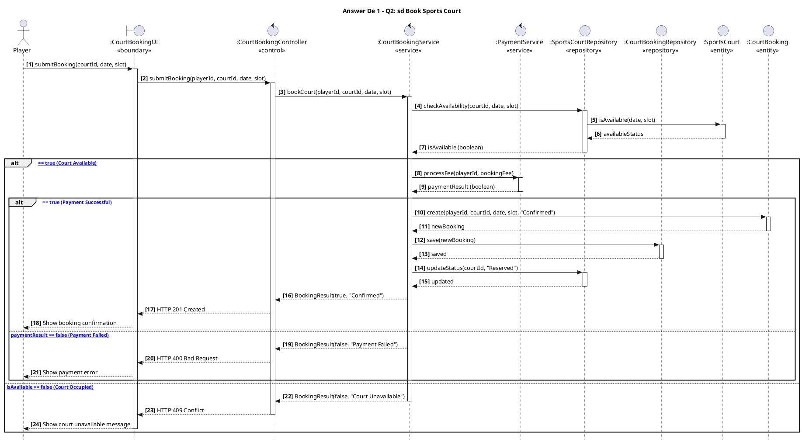

### Question 3 (3.0 pts) – Activity Diagram (`Post-Match Inspection and Check-out`)
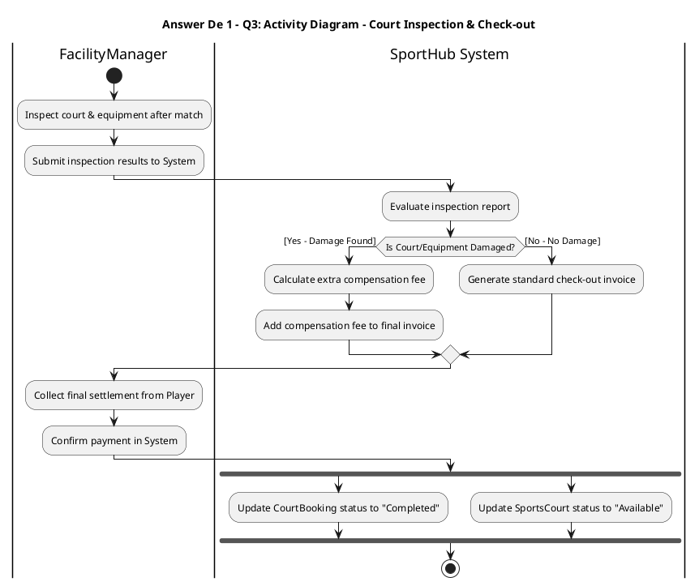

---

## 2. ĐÁP ÁN ĐỀ LUYỆN TẬP SỐ 2: LIBSMART (CLASS + SEQUENCE + STATE)

- **Question 1 (Class Diagram):** `User` <|-- (`Student`, `Lecturer`, `Librarian`); `Book` `"1"` `*--` `"1..*"` `BookCopy`; `User` `"1"` `-->` `"0..*"` `LoanRecord` `"0..*"` `-->` `"1"` `BookCopy`; `LoanRecord` `"1"` `*--` `"0..1"` `FinePayment`; `LoanService` `..>` `IRepository<T>` `<|..` (`BookCopyRepository`, `LoanRepository`).
- **Question 2 (Sequence Diagram):** `Borrower` $\rightarrow$ `:LibraryPortalUI` $\rightarrow$ `:LoanController` $\rightarrow$ `:LoanService` $\rightarrow$ gọi `LoanRepository.hasUnpaidFine(userId)` $\rightarrow$ `alt 1 [hasFine == false]` $\rightarrow$ gọi `BookCopyRepository.checkAvailability(copyId)` $\rightarrow$ `alt 2 [isAvailable == true]` $\rightarrow$ tạo `LoanRecord`, gọi `LoanRepository.save()`, gọi `BookCopyRepository.updateStatus(copyId, "Borrowed")`, trả kết quả nét đứt về UI.
- **Question 3 (State Diagram - `LoanRecord`):**
  ```plantuml
  @startuml
  title Answer De 2 - Q3: State Diagram - LoanRecord Lifecycle
  [*] --> Reserved : submitReservation
  Reserved --> Approved : approveLoan [by Librarian]
  Reserved --> Rejected : rejectLoan [copy unavailable]
  Reserved --> Cancelled : cancelReservation [by Borrower]
  Approved --> Borrowed : pickUpBook
  Approved --> Cancelled : cancelReservation [not picked up]
  Borrowed --> Returned : returnBookOnTime [date <= dueDate]
  Borrowed --> Overdue : dueDateExpired [date > dueDate]
  Overdue --> Returned : payFineAndReturnBook [finePaid]
  Rejected --> [*]
  Cancelled --> [*]
  Returned --> [*]
  @enduml
  ```

---

## 3. ĐÁP ÁN ĐỀ LUYỆN TẬP SỐ 3: FITLIFE GYM BOOKING (3 PARTS)

- **Part 1.1 & 1.2 (Conceptual ERD):** Thực thể `Member` (`memberId`, `fullName`, `phone`), `GymBranch` (`branchId`, `branchName`, `address`), `Trainer` (`trainerId`, `fullName`, `specialty`, `hourlyRate`), `TrainingSession` (`sessionId`, `sessionDate`, `timeSlot`, `status`), `Payment` (`paymentId`, `amount`, `paymentDate`, `status`). Quan hệ: `GymBranch` `1—N` `Trainer`, `Trainer` `1—N` `TrainingSession`, `Member` `1—N` `TrainingSession`, `TrainingSession` `1—1` `Payment`. (Không ghi FK, không ghi kiểu dữ liệu).
- **Part 1.3 (Use Case):** Actor `Member` (`Browse Packages`, `View Trainer Schedules`, `Book Training Session` `«include»` `Verify Trainer Availability` & `Process Payment`, `Cancel Training Session`); Actor `Trainer` (`Publish Schedule`, `Record Session Completion`).
- **Part 1.4 (State Diagram - `TrainingSession`):** `[*] -> Pending (bookSession)`, `Pending -> Confirmed (paySuccess)`, `Pending -> Cancelled (cancelSession)`, `Confirmed -> InProgress (startSession)`, `Confirmed -> Cancelled (cancelBefore24h)`, `InProgress -> Completed (finishSession)`, `Completed -> [*]`, `Cancelled -> [*]`.
- **Part 2 (Class & Sequence Diagram):** `Member` $\rightarrow$ `SessionBookingUI` $\rightarrow$ `SessionController` (kiểm tra JWT Authentication & Authorization) $\rightarrow$ `SessionService` $\rightarrow$ `SessionRepository` $\rightarrow$ `Database`.
- **Part 3 (Design Pattern):**
  - **3.1:** **Decorator Pattern** — **Structural Design Pattern** family.
  - **3.2:** `WorkoutPlan` (`«interface»`) $\triangleleft\cdots$ `StandardWorkout` và `WorkoutAddonDecorator` (`abstract`, chứa `# wrappedPlan: WorkoutPlan`); `WorkoutAddonDecorator` $\triangleleft—$ (`SaunaAccessAddon`, `NutritionCoachingAddon`).
  - **3.3:** Áp dụng khi khách hàng đăng ký gói tập Gym cơ bản và muốn mua kèm linh hoạt nhiều dịch vụ cộng thêm (Xông hơi Sauna, Tư vấn dinh dưỡng, Thuê tủ đồ) để hệ thống tự động cộng dồn giá tiền và mô tả gói tập.
