# BỘ TEMPLATE TẤT CẢ CÁC HÌNH VẼ TRONG ĐỀ THI SWD392 PE (ĐIỀN KHUYẾT LÀ DÙNG NGAY)

> **Thư mục chứa các file `.drawio` mở trực tiếp bằng Draw.io Desktop:**  
> 📁 `c:\Users\ASUS\Desktop\SWD392_PE\FA26_On_Tap\Templates_Hinh_Ve`

---

## 1. DANH SÁCH FILE `.DRAWIO` ĐÃ TẠO SẴN CHO BẠN

Bạn chỉ cần mở phần mềm **Draw.io Desktop** $\rightarrow$ bấm `File -> Open` và chọn:

| STT | Tên File `.drawio` | Công dụng trong phòng thi |
| :-: | :--- | :--- |
| **⭐ 0** | **`00_SWD392_PE_ALL_IN_ONE_TEMPLATES.drawio`** | **File Tổng Hợp 7 Tab trong 1 file duy nhất!** Mở 1 file này lên là có đủ 7 tab ở thanh dưới cùng của Draw.io. |
| **1** | `01_Template_Class_Diagram_PE.drawio` | **Template Câu 1 (3.0đ):** Đựng sẵn 3 cụm (`User` kế thừa + `Entities` có `1`, `0..*`, Composition/Aggregation + `Controller -> Service -> IGenericRepository<T> <- Repositories`). |
| **2** | `02_Template_Sequence_Diagram_PE.drawio` | **Template Câu 2 (4.0đ):** Đựng sẵn khung `sd`, 7 cột Lifelines, 2 khung `alt` (còn chỗ vs hết chỗ; thanh toán thành công vs thất bại), đánh số message 1–24 và mũi tên trả về nét đứt. |
| **3** | `03_Template_Statechart_Diagram_PE.drawio` | **Template Câu 3A (3.0đ / 1.5đ):** Đựng sẵn `●` Initial, `◉` Final, 5 trạng thái chính + 2 trạng thái hủy/lỗi (`Cancelled`, `PaymentFailed/Rejected`), 8 mũi tên có sẵn nhãn `event [guard]`. |
| **4** | `04_Template_Activity_Diagram_Swimlanes_PE.drawio` | **Template Câu 3B (3.0đ):** Đựng sẵn bảng 2 cột **Swimlanes** (`Host/Customer` và `System`), hình thoi **Decision Node**, thanh đồng thời cập nhật 2 trạng thái cuối quy trình. |
| **5** | `05_Template_ERD_Conceptual_And_Logical_PE.drawio` | **Template Part 1.2 & 1.3 (2.5đ):** Gồm cả **Conceptual ERD** (không FK, không kiểu dữ liệu) ở nửa trên và **Logical ERD** (có PK/FK, kiểu dữ liệu, bảng trung gian) ở nửa dưới. |
| **6** | `06_Template_UseCase_Diagram_PE.drawio` | **Template Part 1.3 (1.5đ):** Đựng sẵn khung System Boundary, Actors bên ngoài, các Use Case chuẩn động từ và mũi tên `«include»` / `«extend»` đúng chiều. |
| **7** | `07_Template_4_Design_Patterns_PE.drawio` | **Template Part 3.2 (1.0đ):** Đựng sẵn 4 sơ đồ Class Diagram của đúng 4 Pattern trong đề: **Observer, Strategy, Decorator, Singleton**. |

---

## 2. BẢNG TRA CỨU ĐIỀN KHUYẾT `[...]` CHO TẤT CẢ CÁC ĐỀ TRƯỚC ĐÂY

Khi mở Template lên, bạn chỉ việc thay các ô ngoặc vuông `[...]` theo bảng đối chiếu này:

| Từ khóa trong Template | Đề `FA26_Ex` (StayEase) | Đề `SP26` (EMS Event) | Đề `SU26_PE1` (SmartPark) | Đề `SU26_PE2` (MediCare) | Đề `SU25` (Cinema) | Đề `SU25` (FlowerShop) | Đề `Fall25` (Food) |
| :--- | :--- | :--- | :--- | :--- | :--- | :--- | :--- |
| **`[Role1]`** *(Người đặt/mua)* | `Customer` | `Student`, `Lecturer` | `Customer` *(+ `Vehicle`)* | `Patient` | `Customer` | `Customer` | `User` / `Customer` |
| **`[Role2]`** *(Người cung cấp)* | `Host` | `Organizer` | `ParkingStaff` | `Doctor` | `Staff` | `Staff` | `Restaurant` |
| **`[Role3]`** *(Người quản lý/lễ tân)* | `Staff` / `Admin` | `Admin` | `Admin` | `Receptionist` | `Admin` | `Admin` | `Admin` |
| **`[Resource]`** *(Tài nguyên được đặt)* | `Room` | `Event` | `ParkingSlot` | `DoctorSchedule` | `Showtime` & `Seat` | `Flower` | `Dish` |
| **`[MainTx]`** *(Giao dịch chính)* | `Reservation` | `Registration` | `ParkingTicket` | `Appointment` | `Booking` | `Order` | `Order` |
| **`[Payment]`** *(Thanh toán)* | `Payment` | *(Không bắt buộc)* | `Payment` | `Payment` | `Payment` | `Payment` | `Payment` |
| **`[Service]`** | `BookingService` | `EventService` | `ParkingService` | `AppointmentService` | `BookingService` | `OrderService` | `OrderService` |
| **`[ResourceRepo]`** | `RoomRepository` | `EventRepository` | `ParkingSlotRepository` | `DoctorRepository` | `ShowtimeRepository` | `FlowerRepository` | `DishRepository` |
| **`[MainTxRepo]`** | `ReservationRepository` | `RegistrationRepository` | `ParkingTicketRepository` | `AppointmentRepository` | `BookingRepository` | `OrderRepository` | `OrderRepository` |

---

## 3. HÌNH XEM TRƯỚC (MERMAID LIVE PREVIEW) CỦA TẤT CẢ 7 TEMPLATE

*(Bạn cũng có thể copy khối mã bên dưới vào Draw.io bằng cách bấm: `Arrange -> Insert -> Advanced -> Mermaid...`)*

---

### HÌNH 1A: TEMPLATE CLASS DIAGRAM CHUẨN ĐỀ MỚI (3.0 ĐIỂM)

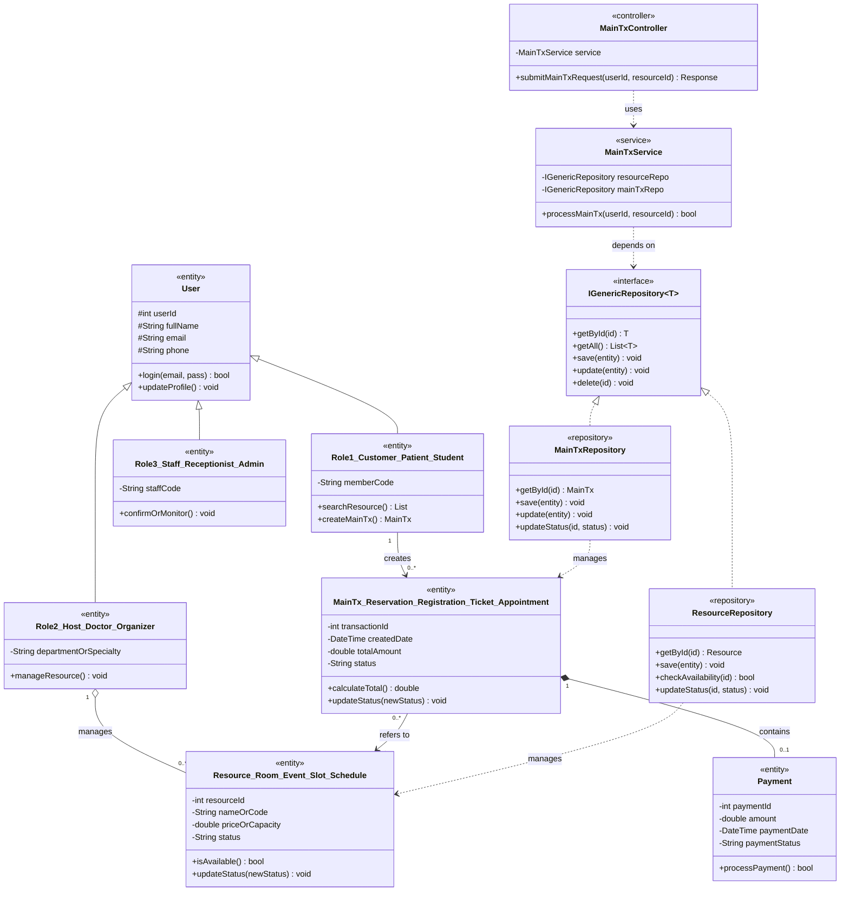

---

### HÌNH 1B: TEMPLATE CLASS DIAGRAM CÓ ASSOCIATION CLASS (ĐỀ `SU25_CYBERAI` & `SU25_FINAL`)

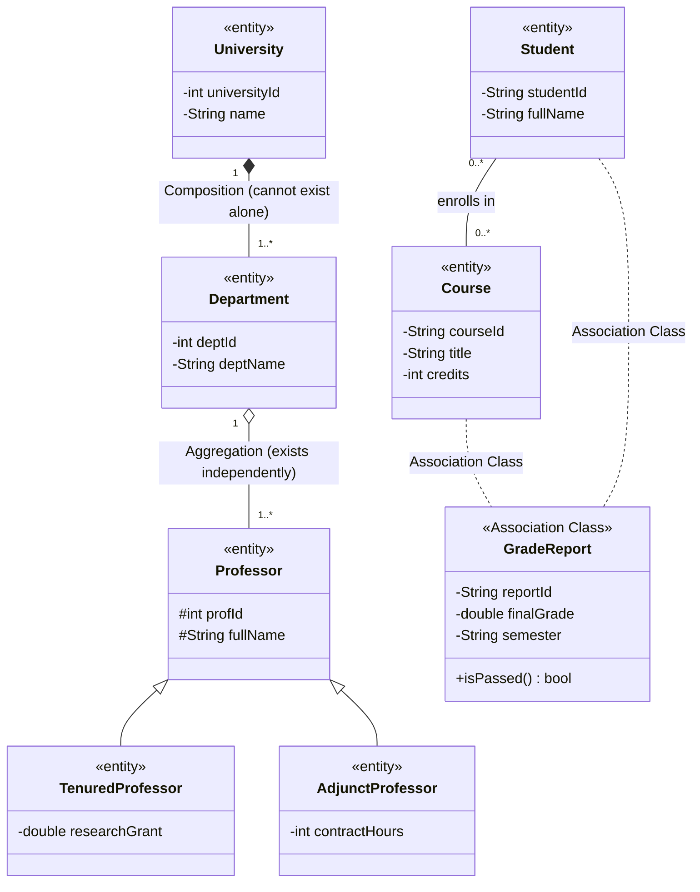

---

### HÌNH 2: TEMPLATE SEQUENCE DIAGRAM CHUẨN 4.0 ĐIỂM (LAYERED + REPOSITORY + 2 KHUNG `ALT`)

```mermaid
sequenceDiagram
    autonumber
    actor Actor as [Actor: Customer / Patient / Student]
    participant UI as :[PortalOrUI]<br/>«boundary»
    participant Ctrl as :[MainTx]Controller<br/>«control»
    participant Svc as :[MainTx]Service<br/>«service»
    participant ResRepo as :[Resource]Repository<br/>«repository»
    participant TxRepo as :[MainTx]Repository<br/>«repository»
    participant Ent as :[Resource] & :[MainTx]<br/>«entity»

    Actor->>+UI: submit[MainTx]Request(resourceId, details)
    UI->>+Ctrl: create[MainTx](userId, resourceId, details)
    Ctrl->>+Svc: process[MainTx](userId, resourceId, details)

    Svc->>+ResRepo: checkAvailability(resourceId)
    ResRepo->>+Ent: getStatusAndCapacity(resourceId)
    Ent-->>-ResRepo: status = "Available"
    ResRepo-->>-Svc: isAvailable (boolean)

    alt [isAvailable == true (Resource is Available / Open)]
        Svc->>+Ent: processPaymentOrSecondCheck(userId, amount)
        Ent-->>-Svc: paymentSuccess (boolean)

        alt [paymentSuccess == true (Payment / Validation Succeeded)]
            Svc->>+Ent: create[MainTx](userId, resourceId, "Confirmed")
            Ent-->>-Svc: new[MainTx]Obj

            Svc->>+TxRepo: save(new[MainTx]Obj)
            TxRepo-->>-Svc: savedSuccess

            Svc->>+ResRepo: updateStatus(resourceId, "Booked / Occupied")
            ResRepo->>+Ent: setStatus("Booked / Occupied")
            Ent-->>-ResRepo: updated
            ResRepo-->>-Svc: statusUpdated

            Svc-->>Ctrl: Result(success = true, confirmationData)
            Ctrl-->>UI: HTTP 201 Created ("Confirmed")
            UI-->>Actor: Display confirmation message
        else [else: paymentSuccess == false (Payment Failed)]
            Svc-->>Ctrl: Result(success = false, "Payment Failed")
            Ctrl-->>UI: HTTP 400 Bad Request ("Payment Failed")
            UI-->>Actor: Display payment error message
        end
    else [else: isAvailable == false (Resource Occupied / Full / Closed)]
        Svc-->>-Ctrl: Result(success = false, "Resource Not Available")
        Ctrl-->>-UI: HTTP 409 Conflict ("Resource Unavailable")
        UI-->>-Actor: Display unavailable / rejection notification
    end
```

---

### HÌNH 3: TEMPLATE STATECHART DIAGRAM (CÂU 3A – ĐỦ $\ge 6$ TRANSITIONS + NHÁNH HỦY/LỖI)

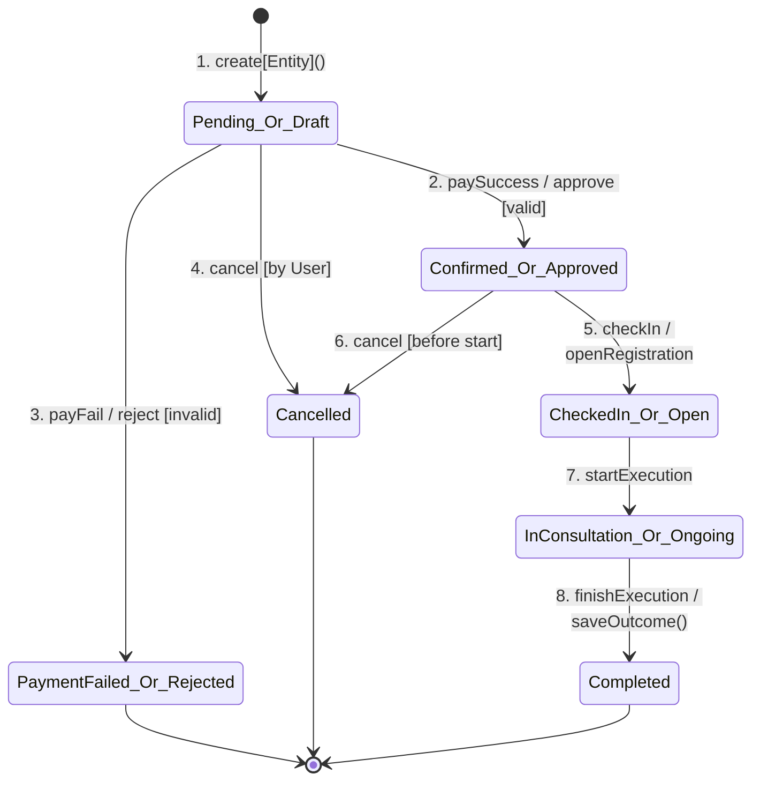

---

### HÌNH 4: TEMPLATE ACTIVITY DIAGRAM 2 SWIMLANES (CÂU 3B – 3.0 ĐIỂM)

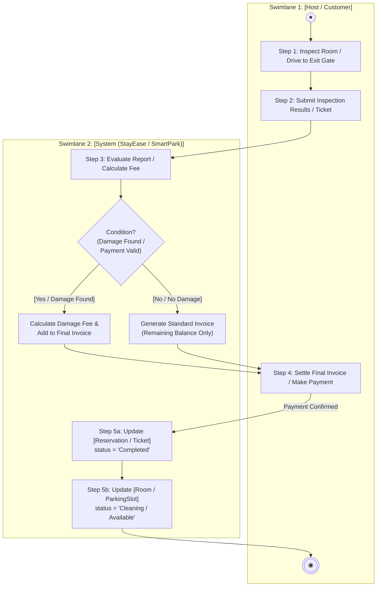

---

### HÌNH 5: TEMPLATE ERD (CONCEPTUAL ERD VS LOGICAL ERD – PART 1.2 & 1.3)

#### 5A. Conceptual ERD (Câu 1.2 – KHÔNG FK, KHÔNG KIỂU DỮ LIỆU)
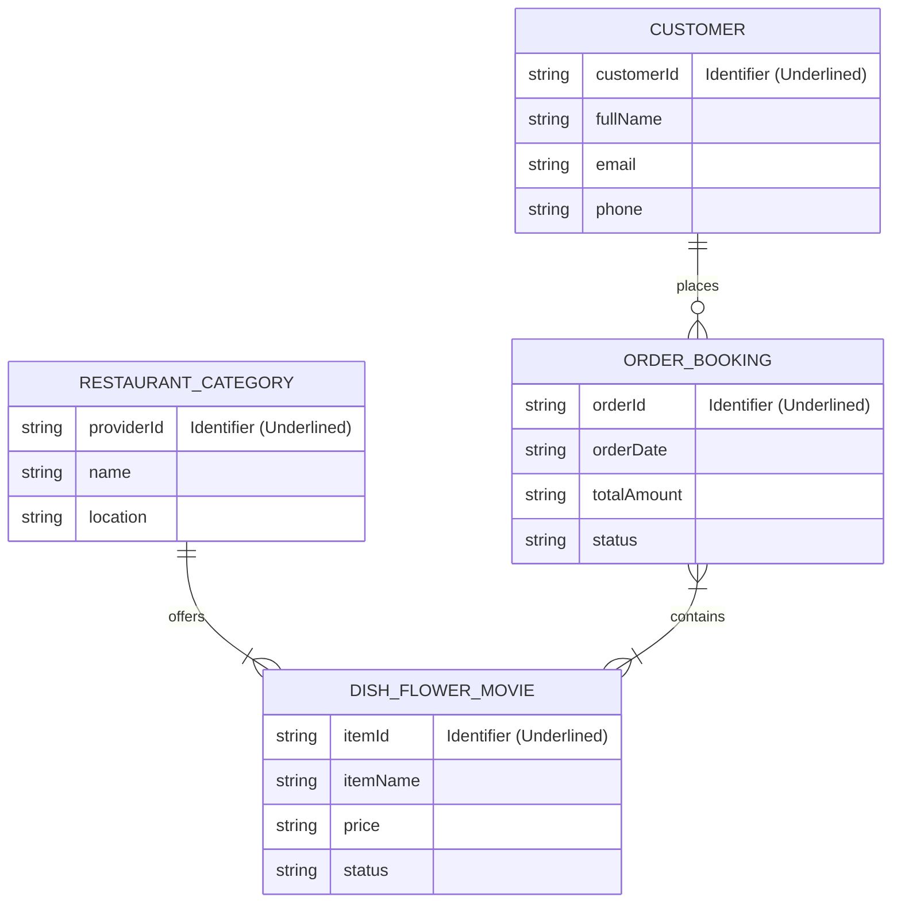

#### 5B. Logical ERD (Câu 1.3 – CÓ PK, FK, KIỂU DỮ LIỆU & BẢNG TRUNG GIAN)
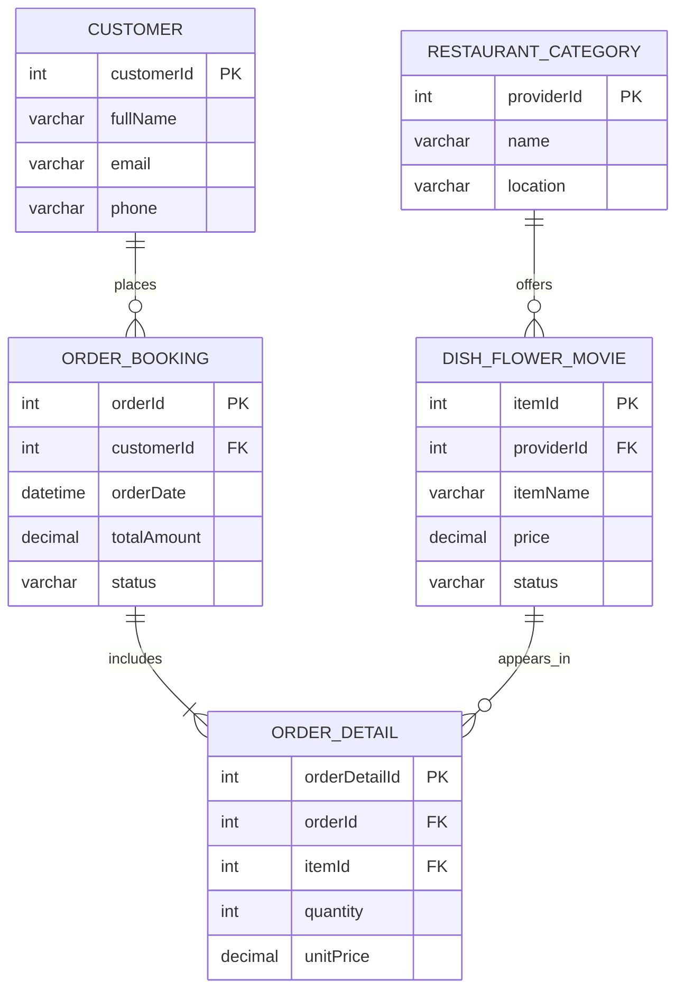

---

### HÌNH 6: TEMPLATE USE CASE DIAGRAM (PART 1.3 ĐỀ CINEMA)

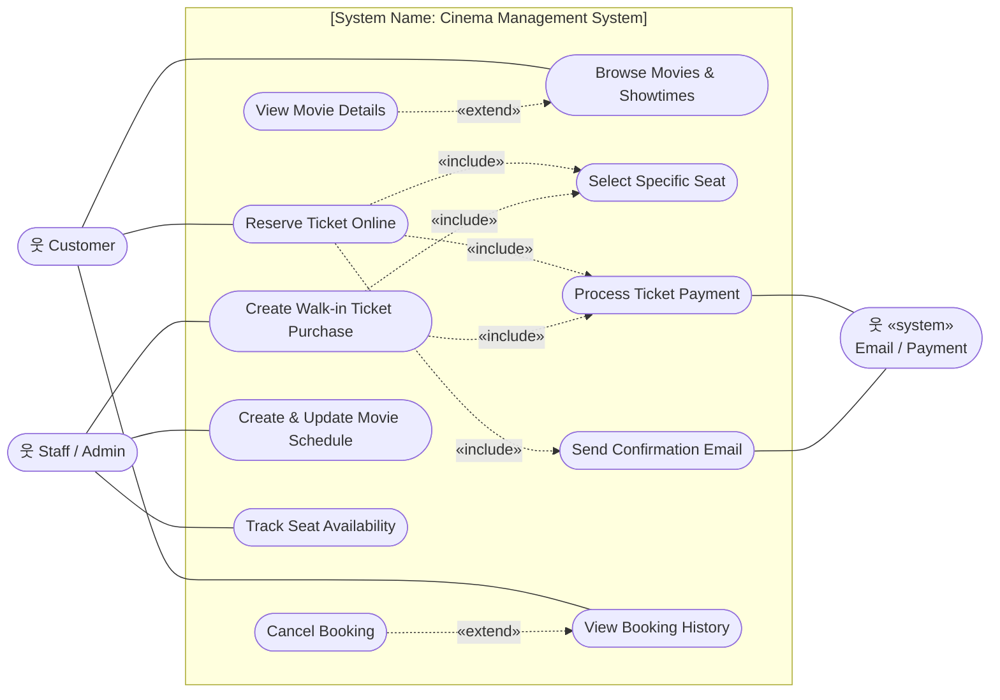

---

### HÌNH 7: TEMPLATE 4 DESIGN PATTERNS CLASS DIAGRAM (PART 3.2)

#### 7.1. Observer Pattern (`SU25_Cinema` & `SU25_CyberAI`)
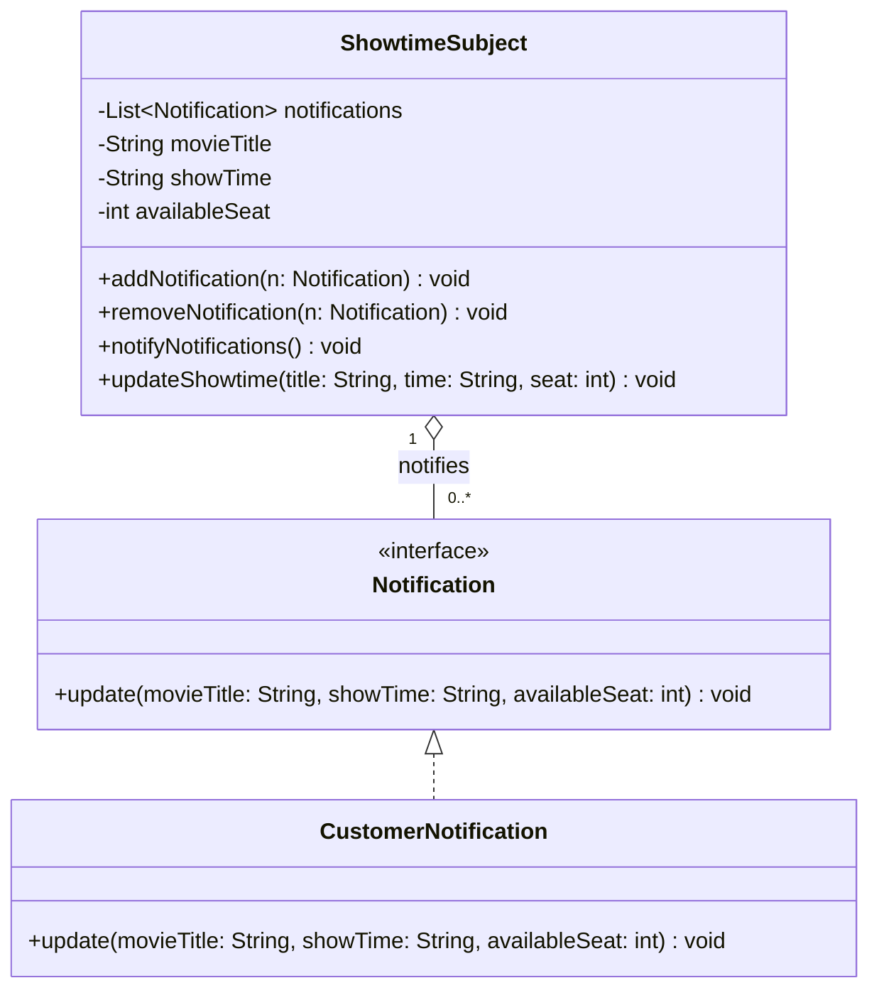

#### 7.2. Strategy Pattern (`SU25_FlowerShop`)
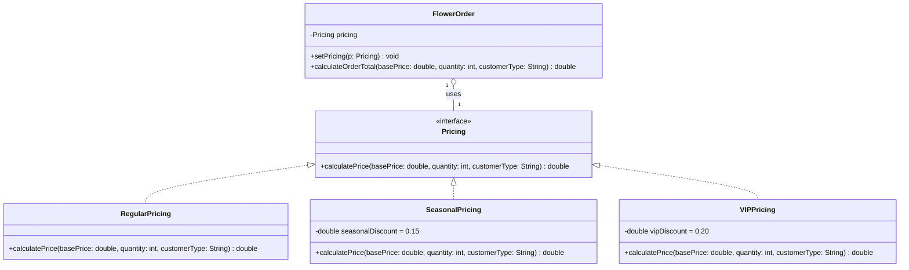

#### 7.3. Decorator Pattern (`Fall25_OnlineFood`)
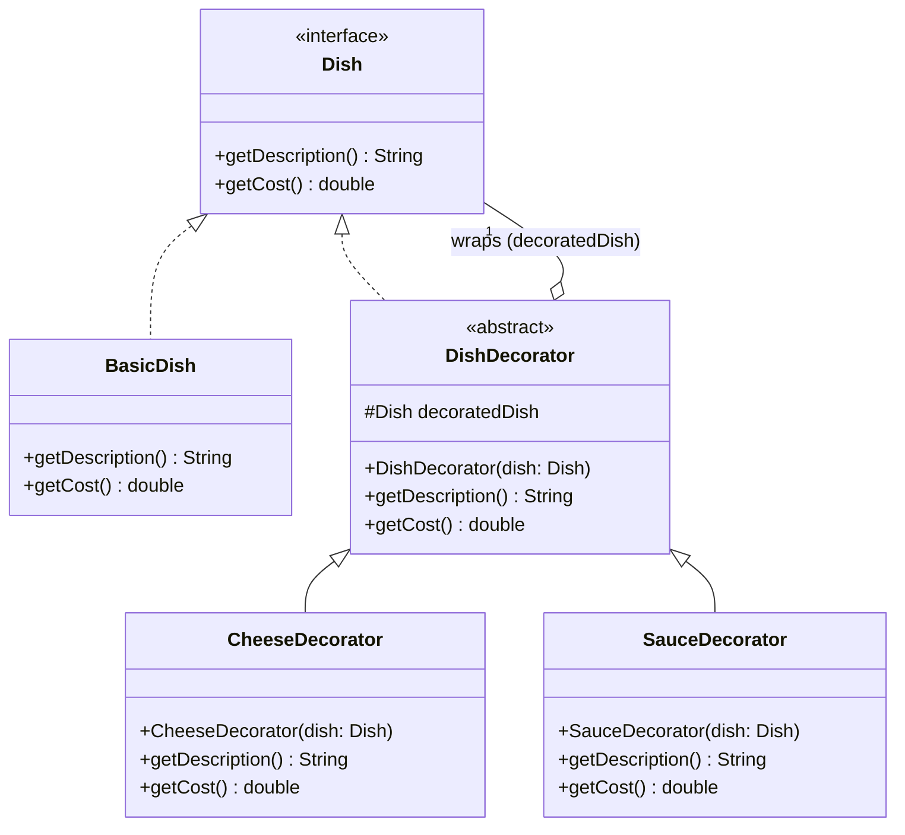

#### 7.4. Singleton Pattern (`SU25_Student` & `SU25_Final`)
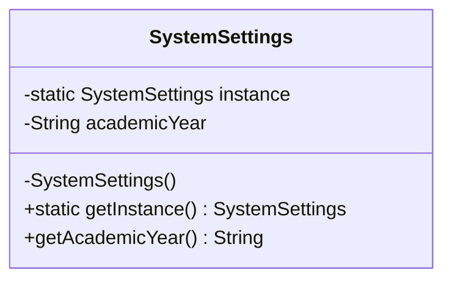
